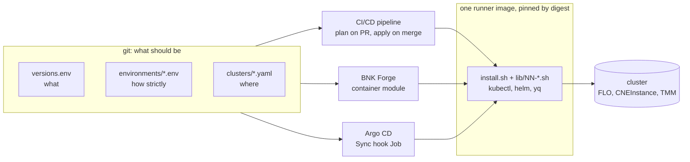

# bnk-host-deploy

**Install F5 BIG-IP Next for Kubernetes (BNK) 2.4.2 in Host mode on a self-managed cluster, from git.**
One tested installer, run by the orchestrator you already use: a CI/CD pipeline, BNK Forge, or Argo CD.

Every phase of the installer automates one step of F5's guide
[Install BNK (Host) on a self-managed cluster using FLO](https://clouddocs.f5.com/bigip-next-for-kubernetes/latest/install/bnk-host-self-managed-flo/),
prints the page it replaces, and converges: run it twice and the second run changes nothing.



> Not an F5 product. Built on F5's documented install flow, tested on kind and on real clusters.

---

## Three ways to run it

| | How an install happens | Best for |
|---|---|---|
| **CI/CD** (`.github/workflows/`) | A pull request changes a cluster file. `plan` validates every object server-side against the live cluster, diffs the CNEInstance and network against what is running, and posts one comment on the PR. Merging runs `deploy`: plan, then install, for exactly the clusters the merge changed. | Platform teams that ship everything through git |
| **BNK Forge** (`forge/`) | This repository is a Forge module source. The module runs the runner image as ten argv-only steps with the credentials as project secrets, then registers the cluster for Day 2. | Teams that want a console, step-level retry and fleet views |
| **Argo CD** (`argocd/`) | An Application renders `argocd/bnk-install` (the cluster file from git as a ConfigMap) and runs the installer as a Sync hook Job inside the cluster. A second Application owns `apps/` with self-heal. | Teams running GitOps everywhere |

The repository variable **`BNK_INSTALLER`** (`pipeline` \| `forge` \| `argocd`) names the one tool that owns
installs, so two orchestrators never race on the same cluster.

## The installer

```
./install.sh --cluster clusters/lab.yaml --plan     # read-only: validate, log in to FAR, diff, render
./install.sh --cluster clusters/lab.yaml            # install or converge
./install.sh --cluster clusters/lab.yaml --phase 70 # one phase
./install.sh --list-phases                          # phases and their F5 guide pages
```

| Phase | F5 guide step | Notes |
|---|---|---|
| `00-preflight` | System requirements | tooling, API, Kubernetes 1.35, CNI, storage, CPU, before anything changes |
| `05-nodes` | Label TMM nodes | applies `app=f5-tmm` to the declared node, proves hugepages |
| `10-prereqs` | Install cert-manager | Multus first (FLO crash-loops without its CRD), cert-manager, CA chain |
| `20-registry` | Pull secret for F5 Artifact Registry | Helm login proves the key; `far-pull-secret` in both namespaces |
| `30-flo` | Install FLO | installs or upgrades to the pinned chart |
| `40-certs` | Prepare the CNE core | `f5-cert-gen`; refuses empty certificates (needs `make` and `python3`) |
| `45-attachments` | (network) | TMM's Multus legs, before the CNEInstance names them |
| `50-cneinstance` | Install a CNE instance | applies, waits for reconcile and CRDs, **not** for Available |
| `55-network` | (network) | VLANs, VIP pool, GatewayClass, retried through F5's webhook |
| `60-license` | License your cluster | retries only the known quota race |
| `65-ready` | | waits for Available: TMM is configured only once licensed |
| `70-verify` | the guide's "Expect:" lines | assertions; stamps provenance |

Configuration is layered; later wins:

| File | Answers |
|---|---|
| `versions.env` | **what**: BNK 2.4.2, FLO `v2.30.0-0.11.4`, cert-gen, Calico, cert-manager, Multus, tool versions |
| `environments/<env>.env` | **how strictly**: size, timeouts, licence rules, strict preflight |
| `clusters/<name>.yaml` | **where**: context, TMM node, storage, network legs, and `enabled` |
| `clusters/<name>.attachments.yaml`, `.network.yaml` | TMM's data-plane legs and network, when the cluster has them |
| `profiles/host.yaml` | the CNEInstance template for Host mode |

Secrets never live in git. The installer reads `FAR_PULL_JSON` (path to the FAR service-account key) and
`BNK_LICENSE_JWT` or `BNK_LICENSE_FILE` from the environment.

## Pipeline features

- **Plan on every PR** against the live cluster, posted as one sticky comment: a per-cluster table,
  every planned change, `kubectl diff` of the CNEInstance and TMM network, the rendered CNEInstance.
- **Affected clusters only**: `ci/targets.sh` maps changed paths to clusters (a `versions.env` change
  selects every enabled cluster; a docs change selects none).
- **Plan, then apply, in the same job** on merge; one deploy at a time, never cancelled half way.
- **Provenance**: every install annotates the CNEInstance (commit, orchestrator, actor, run URL) and
  appends to `f5-cne-core/bnk-deploy-ledger`.
- **Nightly drift**: `drift.yml` plans every enabled cluster against `main` and opens, updates or closes
  a "Drift" issue; then re-verifies health.
- **Forge module validated in CI** with Forge's own catalog validator (`tests/forge.sh`).
- Runs unchanged on GitHub Actions and on Gitea Actions.

## Runner image

`Dockerfile` builds `debian:bookworm-slim` + the installer + pinned, checksum-verified kubectl, helm and yq,
running as uid 1000 (Forge refuses root images). `bnk-host <phase>` is the entrypoint. The `image`
workflow publishes it on a version tag; `forge/pin-image.sh` and `argocd/pin-image.sh` pin its digest.

## Repository map

```
install.sh  uninstall.sh  versions.env      the installer and its pins
lib/                                         one file per phase, plus cluster loading and rendering
environments/  profiles/  clusters/          configuration layers
bin/bnk-host  Dockerfile                     the runner image
.github/workflows/  ci/                      ci, plan, deploy, apps, drift, image, uninstall
forge/                                       BNK Forge module (pack + artifact) and blueprint
argocd/                                      Argo CD Applications and the install Job
apps/  docs/examples/                        application delivery, example app
tests/                                       lint, render, cluster files, Forge validation
lab/  instruqt/                              the Instruqt training lab built on this repository
```

## Tests

```
./tests/lint.sh      # bash -n, shellcheck, YAML/JSON well-formedness
./tests/render.sh    # CNEInstance renders, host and two-leg lab shapes
./tests/cluster.sh   # every cluster file valid; six broken fixtures rejected
./tests/forge.sh     # forge/ through BNK Forge's own validator
```

## Training lab

`instruqt/bnk-host-install` is an Instruqt track built on this repository: a bare three-node cluster to a
licensed BNK serving traffic, via any of the three paths, with every step explained. `lab/` builds the
sandbox around it (Gitea with Actions, VS Code, an FRR edge router and client, a topology page).

## Licence

MIT. See `LICENSE`.
