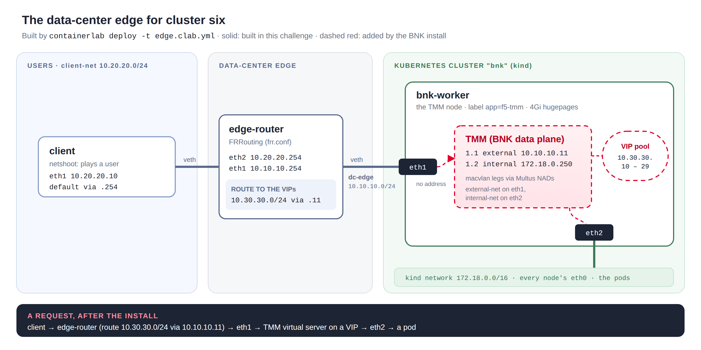

# Monday, 10:30: Sam builds the edge, and lets you hold the cables

By lunchtime this is what will exist, and you will know why each piece is there:



The solid parts you build now. The dashed red parts are what the BNK install adds this afternoon:
**TMM** taking the address `10.10.10.11` on `bnk-worker`'s `eth1`, and the **VIP pool** behind it.

---

## Step 1: Why a load balancer needs extra network legs

Remember from this morning: Calico gives every pod exactly **one** network interface, `eth0`, on the
cluster's pod network. For an app that is all it needs. For TMM it is not enough. TMM must be
reachable from Sam's routers on an address in Sam's network, and it must reach pods on the other side.

Two pieces of Linux and Kubernetes make that possible, and you will meet both again during the
install.

**Multus** is a CNI plug-in that calls other CNI plug-ins. With Multus, a pod still gets its normal
`eth0` from Calico, plus extra interfaces described by **NetworkAttachmentDefinition** objects
(*NADs* for short). A NAD is a recipe: "when this pod starts, create an interface of this type, on
that node's card." BNK's installer applies two of them for TMM, and installs Multus itself first.

**macvlan** is the kind of interface those recipes ask for. A macvlan interface is a child of a real
network card with its *own MAC address*. To the switch on the other end, it looks like a separate
machine plugged into the same port. So when TMM gets a macvlan on `bnk-worker`'s `eth1`, TMM appears
on Sam's network as a host of its own, with its own self IP, and the node itself needs no address
there at all.

There is one catch, and it explains a detail in the picture: **a macvlan child cannot talk to its own
parent card.** If TMM's inner leg hung off `bnk-worker`'s main card, `eth0`, TMM could reach every node
except the one it lives on. So `bnk-worker` has a second card into the cluster network, `eth2`, used
only as TMM's internal parent. The team added it when they built the cluster. Look at the node's
cards today:

```run
docker exec bnk-worker ip -br link
```

`eth0` (the node's own, on the kind network), `eth2` (TMM's future internal parent), and no `eth1`
yet. That is the port you are about to cable.

---

## Step 2: Read the topology before you build it

Sam's rule: never deploy a network file you have not read.

```run
cat /opt/lab/edge/edge.clab.yml
```

Walk through it from the top:

- `name: edge` and `prefix: ""`: the lab is called *edge*, and the containers keep the plain names you
  will type all day, `edge-router` and `client`.
- `mgmt`: containerlab gives each node a management interface on its own network
  (`172.20.40.0/24`), kept out of the data path. That is how a real network keeps its out-of-band
  management separate from the traffic it carries.
- **`edge-router`** runs **FRRouting** (FRR), the open-source routing suite that many commercial
  routers and SONiC are built on, with packet forwarding switched on. Its whole configuration is two
  files from the repository, mounted in.
- **`client`** runs *netshoot*, a container full of network tools (`curl`, `traceroute`, `tcpdump`)
  that plays a user. Its address and its default route, via the router, are set by the `exec` lines.
- **`bnk-worker`** is `kind: ext-container`: a container that *already exists*, your Kubernetes node.
  containerlab does not create it. It only plugs a cable into it.
- `links:` are the cables, one per line: router `eth1` to `bnk-worker` `eth1` (the **dc-edge**
  segment, where TMM will stand), and router `eth2` to client `eth1` (**client-net**, where the users
  are).

Now the router's configuration, the same commands a network engineer types on a physical router:

```run
cat /opt/lab/edge/edge-router/frr.conf
```

Two interfaces with addresses, and one line that matters more than any other today:

```
ip route 10.30.30.0/24 10.10.10.11
```

*"Anything for the VIP range, send to 10.10.10.11."* That is where TMM will stand.

> **A VIP** (*virtual IP*) is an address that belongs to a service, not to a machine. When Lena's team
> asks BNK for a Gateway this afternoon, BNK hands out a VIP from its pool (`10.30.30.10` to `.29`)
> and TMM answers on it. Users can only reach a VIP if the network sends the VIP range to TMM. Here a
> static route does that. Large sites let TMM *announce* its VIPs to the routers with **BGP** instead
> (BNK's dynamic routing), so the network learns them by itself and stops sending traffic to a TMM that
> has gone away. This router speaks BGP too, so the lab can grow into that.

---

## Step 3: Deploy it

```run
lab network
```

The command prints the topology, runs `containerlab deploy`, and shows containerlab's own view of what
it built: every node, its image, its management address, its state. Then it shows what got cabled
and tests the path. Read the four blocks as they go by.

Two things to notice:

- `bnk-worker` now has an **`eth1`**, **up, with no address**. Exactly what TMM's macvlan needs: a
  port into Sam's network that the node itself does not use.
- The last test says the router **cannot** reach `10.10.10.11` yet. That is the right answer. Nothing
  owns that address until BNK is installed.

Switch to **Lab Topology**: the *client* and *edge-router* boxes are green.

---

## Step 4: Look at it the way Sam would

containerlab's inventory of the lab, any time:

```run
containerlab inspect -t /opt/lab/edge/edge.clab.yml
```

The router's routing table, from FRR's own shell (`vtysh` is the command line every FRR router has):

```run
docker exec edge-router vtysh -c 'show ip route'
```

| You will see | What it means |
|---|---|
| `C>* 10.10.10.0/24 is directly connected, eth1` | **C**onnected: the router sits on dc-edge |
| `C>* 10.20.20.0/24 is directly connected, eth2` | and on client-net |
| `S>* 10.30.30.0/24 [1/0] via 10.10.10.11, eth1` | **S**tatic: the VIP range lives behind TMM's address |

---

## Step 5: Follow a packet that cannot arrive yet

From the user's chair, try to reach the VIP Lena's service will use this afternoon:

```run
docker exec client traceroute -n -w 1 -q 1 -m 3 10.30.30.10
```

Hop 1 answers: the edge router, `10.20.20.254`. Hop 2 is silence. The router forwards toward
`10.10.10.11`, and nobody is there.

Ask the router what it knows about that neighbour:

```run
docker exec edge-router ip neigh show 10.10.10.11
```

`FAILED` or `INCOMPLETE`: the router asked "who has 10.10.10.11?" on dc-edge (an ARP request) and
nobody answered. Hold on to this picture. After the install, hop 2 will be TMM and this entry will
hold TMM's MAC address.

---

## Step 6: The network and the repository agree

The addresses you just built are not invented by the network. They are already written in the
repository as the desired state of this cluster. Open **VS Code** and find:

- `clusters/lab.network.yaml`: TMM's two VLANs, `external` with self IP `10.10.10.11` on interface
  `1.1` and `internal` with `172.18.0.250` on `1.2`, the VIP pool, and the GatewayClass.
- `clusters/lab.attachments.yaml`: the two NADs, the "recipes" from step 1: `external-net` (macvlan on
  `eth1`) and `internal-net` (macvlan on `eth2`).

Sam's edge says *"VIPs live behind 10.10.10.11"*. The repository says *"TMM takes 10.10.10.11"*. Two
teams, two files, one fact, and nobody had to send an email. Keeping files like these in agreement,
and applying them, is what the rest of the day automates.

Sam nods at the green boxes on the wall. *"Your turn. Show me what you're going to run."*

Press **Check**: it verifies the router, the client, the cable to `bnk-worker` and the route to the VIP
pool.
