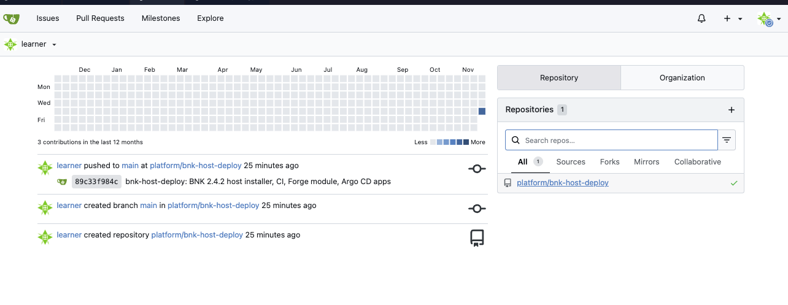
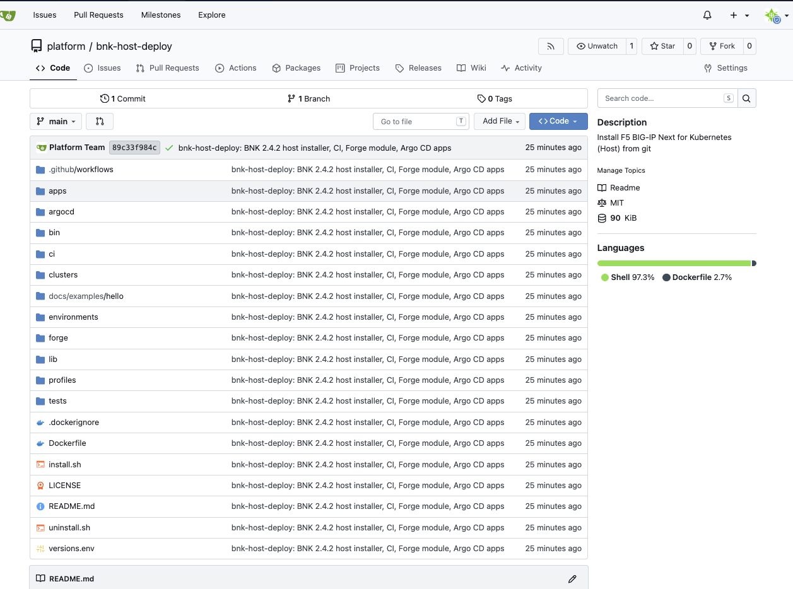
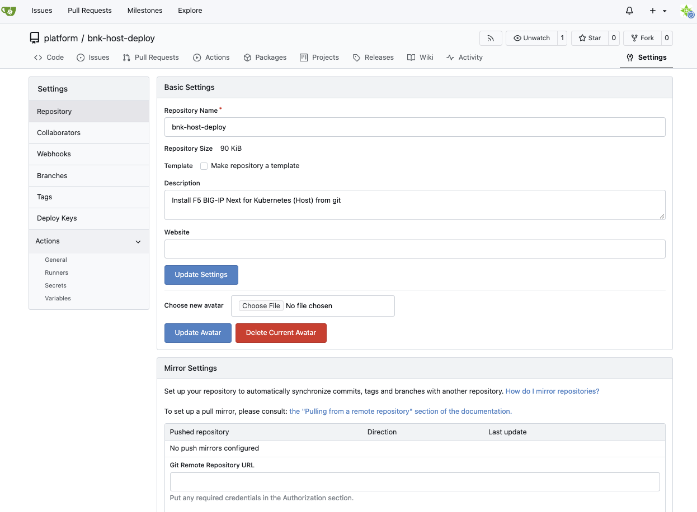
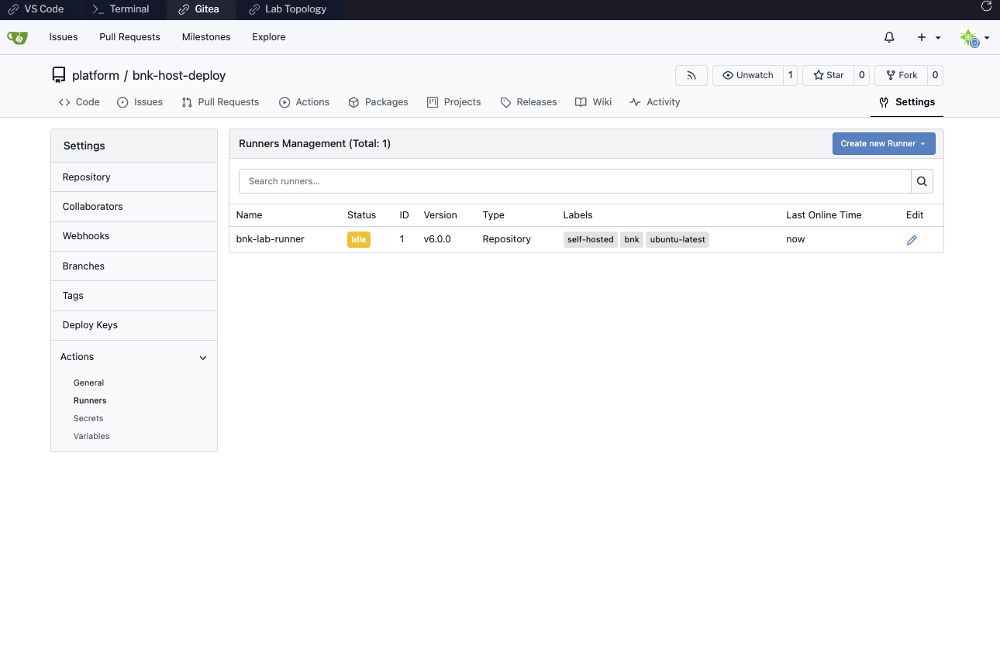

# Monday, 11:30: reading the install guide that runs itself

<!-- story -->
### The repository that remembers

Back at the desk, Priya opens a browser tab. *"This is the reason cluster six will be different."*

It is the team's `bnk-host-deploy` repository. Every step of F5's install guide is in it, as code,
together with everything the team learned the hard way on clusters one to five: the order that
matters, the race conditions, the certificate that once came out empty.

*"Before you run anything,"* Priya says, *"read it the way you would review a colleague's pull
request. If you can't explain what a step does, it doesn't run on my cluster."*

### Four questions, four files

A good install repository answers four questions without anyone having to ask a person:

1. **What** gets installed? Exact versions, never "latest".
2. **Where?** Which cluster, which node, which network.
3. **How strictly?** A lab forgives a warning. Production does not.
4. **Who changed what, when?** Git history, and the pipeline's run logs.

`bnk-host-deploy` keeps each answer in its own file, so a change to one question touches one file,
and a reviewer can tell what kind of change a pull request is from the file list alone.

---

---

## Step 1: Find the repository

Open the **Gitea** tab. Gitea is Northwind's git server, the same idea as GitHub or GitLab, running
inside this lab. You are already signed in as **`learner`**, and the dashboard shows the one
repository you will work in. Click **platform/bnk-host-deploy**.



The repository page lists the folders you will meet today: `.github/workflows` (the pipeline),
`clusters`, `environments`, `lib` (the install phases), `forge`, `argocd`, and the `README.md`.



Now open the **VS Code** tab. Its Explorer shows the same files. This is your **working copy**.

Here is how the two relate, because the whole afternoon depends on it. **git** records every change to
a set of files as a *commit*: who, when, what, and a message saying why. The copy in Gitea is the
**remote**, the team's shared truth. The copy in VS Code, `/root/workspace/bnk-host-deploy`, is your
own **clone** of it. You change files there, commit, and *push* them up to Gitea on a **branch**, a
line of work separate from `main`. Nothing you do in your working copy affects anyone until you push,
and nothing reaches `main` without a **pull request** that someone can review.

At Northwind `main` is **protected**. Prove it to yourself: make an empty commit and try to push it
straight to `main`.

```run
cd /root/workspace/bnk-host-deploy && git commit --allow-empty -qm "testing the guard rail" && git push origin main
```

Gitea refuses: *Not allowed to push to protected branch main*, declined by the server's pre-receive
hook. That refusal is a feature: it means every change to how BNK is installed gets a second pair of
eyes. Throw the test commit away so your copy matches the remote again:

```run
git reset -q --hard origin/main && git status -sb | head -1
```

`## main...origin/main`, and nothing ahead: clean.

---

## Step 2: The four files that answer the four questions

Open these in **VS Code**, in this order, and read the comments: they explain the *why*.

**`versions.env` answers *what*.** `BNK_VERSION=2.4.2`, the F5 Lifecycle Operator chart
`FLO_VERSION=v2.30.0-0.11.4`, the release manifest, cert-gen, Calico, cert-manager, Multus, and even
the versions of kubectl, helm and yq the installer runs with. Notice the comment on
`CNE_RELEASE_MANIFEST`: the short tag `2.4.2`, not the long one, because the operator silently fails
with the long form. That sentence cost someone an afternoon once. Now it costs nobody anything.

**`environments/lab.env` answers *how strictly*.** Compare it with `production.env`:
`BNK_STRICT_PREFLIGHT=true` in production turns every preflight warning into a hard stop, and the lab
allows a longer wait because a lab is always the coldest cluster you will ever install on.

**`clusters/lab.yaml` answers *where*.** The context, the storage class, TMM's two network legs, and
two lines still empty: `tmm.nodes: []` and `enabled: false`. Nothing will be installed on this
cluster until someone declares, in a reviewed pull request, that it should be, and where TMM runs.
That someone will be you, this afternoon.

**`profiles/host.yaml` answers *in what shape*.** The CNEInstance template for host mode,
`dpu.enabled: false`. The installer fills in its blanks from the other three files.

Why split it like this? Imagine upgrading BNK on twenty clusters if versions, policy and placement all
lived in one file per cluster: twenty edits, and any one of them might change a timeout by accident.
Here an upgrade is **one line in `versions.env`**, and the pipeline works out which clusters it
affects. Adding cluster seven is one new file in `clusters/`.

---

## Step 3: Every phase is a page of F5's guide

The installer is `install.sh` plus one small file per phase in `lib/`. Ask it what it would do:

```run
./install.sh --list-phases | cut -c1-80
```

Thirteen phases, each tied to the page of F5's guide it automates. The full line also holds the link.
Here is what each one does, and what tends to go wrong when a person does it by hand:

| Phase | F5 guide step | What goes wrong by hand |
|---|---|---|
| `00-preflight` | System requirements | You discover a missing tool, or too few CPUs, 25 minutes in |
| `05-nodes` | Label TMM nodes | Forget the label and the operator never creates TMM, with an error that never mentions labels |
| `10-prereqs` | Install cert-manager (+ Multus, the CA issuer) | Apply the issuer before cert-manager's webhook answers and it fails, sometimes |
| `20-registry` | Pull secret for F5 Artifact Registry | Create it in one namespace instead of two and half the images never pull |
| `30-flo` | Install FLO | Install it before Multus exists and it crash-loops |
| `40-certs` | CWC and OTEL certificates | Without `make` and `python3`, F5's cert-gen writes **empty** certificates and reports success |
| `45-attachments` | TMM's network legs | Must exist before the CNEInstance names them |
| `47-inference` | Install a CNE instance (AI inference option) | Skipped unless the cluster file enables AI inference. When it does, the inference CRDs must exist before the CNEInstance asks BNK to use them, or BNK's controller stops. You will meet it in the last challenge |
| `50-cneinstance` | Install a CNE instance | The one object that makes FLO install ~80 components |
| `55-network` | TMM VLANs, VIP pool, GatewayClass | F5's validation webhook refuses everything until it is up |
| `60-license` | License your cluster | A race with a quota object fails roughly one install in ten |
| `65-ready` | wait for TMM | Wait for "Available" *before* licensing and you wait forever |
| `70-verify` | the guide's "Expect:" lines | Turned into checks that fail the run |

Open `lib/50-cneinstance.sh` and read its opening comment. It explains why this phase deliberately does
**not** wait for BNK to become Available: on a licensed install, TMM is only configured after the
licence is active, so waiting here could only time out. The earlier version of this installer had
exactly that deadlock. A comment like that is the difference between a repository and a folder of
scripts.

---

## Step 4: Run the tests, the way CI will

A pull request is only as safe as the checks that run on it. These need no cluster at all:

```run
./tests/cluster.sh
```

It validates every cluster file, then feeds the validator **six broken files on purpose** (a name that
does not match, an unknown environment, an enabled cluster with no TMM node, two TMM nodes, a typo in
`enabled`) and confirms each one is rejected. A validator nobody has tested is a hope, not a check.

```run
./tests/render.sh
```

It renders the CNEInstance exactly as phase 50 will, for the plain host profile and for this lab's
two-leg network, and checks the result field by field.

---

## Step 5: Meet the pipeline

Open `.github/workflows/` in **VS Code**. Four files carry the whole delivery process:

| Workflow | Runs when | What it does |
|---|---|---|
| `ci.yml` | every pull request and every push | the tests you just ran, plus BNK Forge's own validator on the Forge module |
| `plan.yml` | a pull request that changes *how* or *where* BNK is installed | runs the installer in **plan mode** against the real cluster and posts the result on the pull request. **Changes nothing.** |
| `deploy.yml` | a merge to `main` | plans, then installs, only on the clusters that merge affected |
| `apps.yml` | a merge that changes `apps/` | delivers applications (later today) |

This is **CI/CD**. **Continuous integration** checks every change automatically before it is merged.
**Continuous delivery** puts merged changes into effect automatically. For infrastructure, the safe
rhythm is **plan, review, apply**: the pipeline shows exactly what a change will do, a person approves
it by merging, and only then is it applied. Nobody runs an installer from a laptop. Every change has a
reviewer, a log and a commit you can roll back to.

These are GitHub Actions workflow files. Gitea Actions runs them unchanged, so everything you learn
here works the same way on GitHub.

---

## Step 6: Give the pipeline a runner, beside the cluster

A workflow is only a description until something runs it. Look at the line every job that touches the
cluster shares:

```yaml
runs-on: [self-hosted, bnk]
```

That line asks for a **runner**: a small agent that waits for jobs, runs them, and reports back. GitHub
offers *hosted* runners on the internet, but they cannot reach a private cluster's API server, and
nobody should hand them its credentials. Infrastructure pipelines therefore use a **self-hosted
runner** placed next to the cluster: it reaches the API privately, and the cluster's credentials never
leave the building. The labels it registers with, `self-hosted` and `bnk`, are how a workflow chooses
it.

Register one:

```run
lab runner
```

It downloads the runner and verifies its checksum, asks Gitea for a registration token **scoped to
this one repository** (single use, never shown), registers with the labels `self-hosted`, `bnk` and
`ubuntu-latest`, and starts it as a service.

Now find it in Gitea. On the repository page, open **Settings** (top right):



In the left-hand menu, expand **Actions** and choose **Runners**:



`bnk-lab-runner`, **Idle**, scoped to this **Repository**, with its three labels. Idle is good news: it
is connected and waiting for its first job, which you will give it in the next challenge. While you
are here, glance at **Secrets** and **Variables** under Actions: both are empty today. They will not
stay that way.

On the **Lab Topology** tab, the Gitea box now reads *runner: online beside the cluster*.

Priya leans over. *"Good. You've read it, it's tested, and it has somewhere to run. Now let's give it
something to run."*

Press **Check** when the runner is online.
