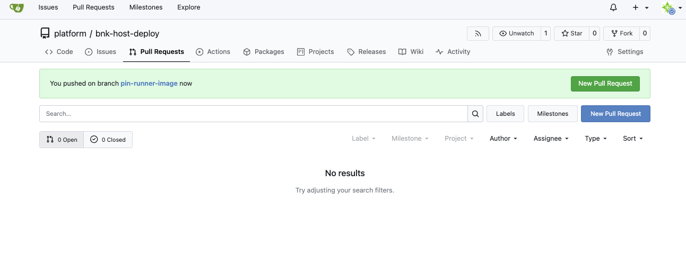
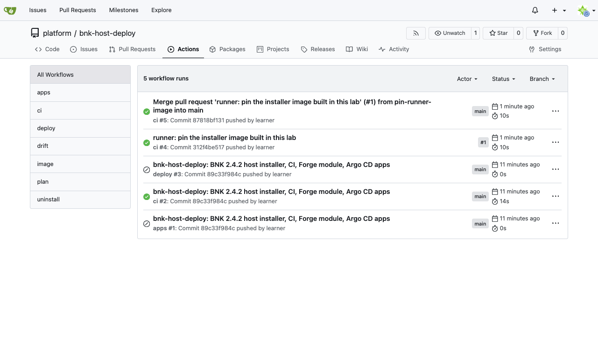
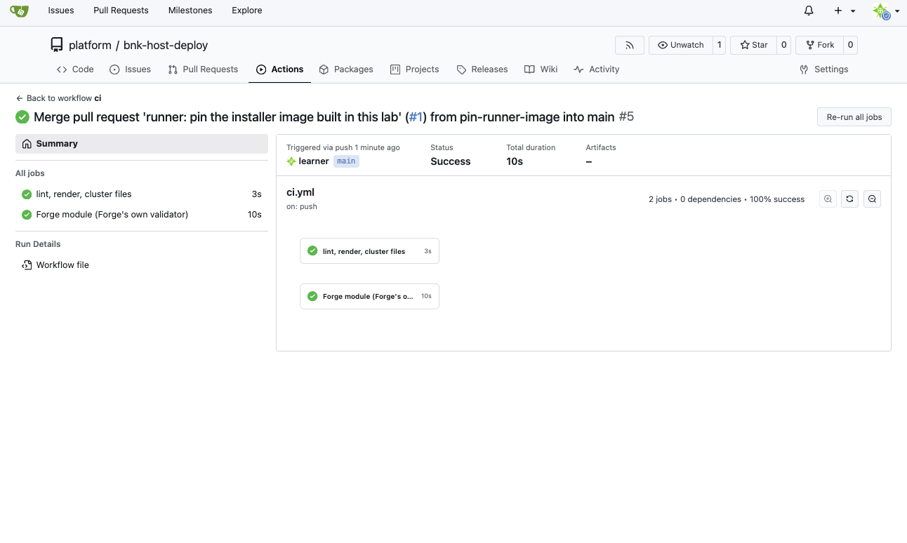
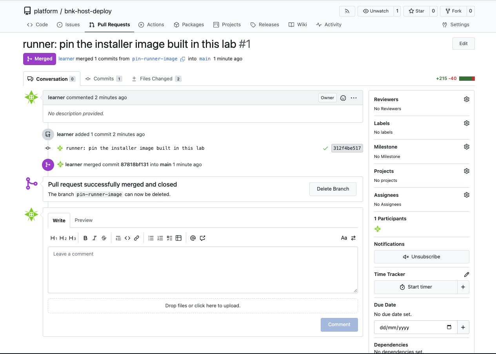
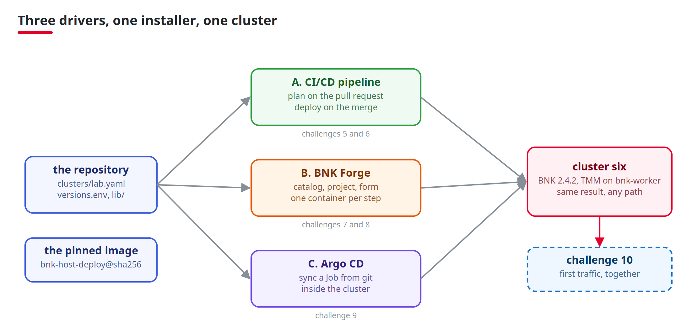

# Monday, 13:30: one installer, sealed, and your first pull request

### After lunch: the question that ends arguments

Jonas from security stops by with a question that has ended many projects:

*"When this cluster gets audited next year, can you prove exactly which code installed BNK on it? Not
'the script in the repo'. The exact build."*

Priya smiles. She has been waiting for someone to ask. The answer is to stop running the installer
as loose files and **package** it: one container image holding the installer and the exact versions
of kubectl, helm and yq it needs, identified by a fingerprint of its content. The pipeline, BNK Forge
and Argo CD will all run *that image*, so whichever tool installs BNK, it is provably the same code.

Your job: build it, publish it, write its fingerprint into the repository, and get that change onto
`main` the proper way.

### Tags move. Digests do not.

A container image lives in a **registry** under a name like `registry/repository:tag`. The trouble with
tags is that they are labels anyone can move: `:2.4.2` today and `:2.4.2` next month might be
different images.

Every image also has a **digest**, `sha256:…`, the hash of its content. Change one byte and the digest
changes. A digest cannot be moved or reused. Pin an image by digest and you have Jonas's proof.

BNK Forge enforces this: it refuses to run any module image that is not pinned by digest, and any
image that runs as root.

---

---

## Step 1: Look at what you are about to package

Open **VS Code** and read two files.

`Dockerfile` builds the image: a small Debian base, the tools the installer needs (`kubectl`, `helm`,
`yq`, plus `make` and `python3`, which F5's certificate generator quietly depends on), each one
downloaded at the version in `versions.env` and **checked against the checksum its publisher
publishes**, and finally the installer itself. Note the last lines: `USER 1000` (the image never runs
as root) and `ENTRYPOINT ["bnk-host"]`.

`bin/bnk-host` is that entrypoint. It turns every install phase into a verb (`preflight`, `prereqs`,
`flo`, `certs`, …), so a tool can run the install step by step and show you each step separately. Keep
that in mind if you choose the Forge path later.

---

## Step 2: Build it, publish it, pin it

```run
lab image
```

Read the four blocks as they go by:

1. **A registry starts.** Northwind would use Harbor or GHCR, and the lab runs a plain `registry:2` on
   port 5000. It answers on two addresses: `localhost:5000`, which is how this machine's Docker (and so
   BNK Forge) pulls, and `172.18.0.1:5000`, which is how the cluster's nodes (and so Argo CD's install
   job) pull. One registry, two front doors.
2. **`docker build`** runs the Dockerfile against **your working copy**, then proves the result runs
   as uid 1000.
3. **Push, then read back the digest.** The registry stores the image and returns its fingerprint:
   `sha256:` followed by 64 hex characters.
4. **Pin.** The digest is written into the two files that point at the image:
   `forge/bnk-host/bnkforge.artifact.json` (for Forge) and `argocd/bnk-install/job.yaml` (for Argo CD).

The change is on your disk only. Look at it the way a reviewer will:

```run
git -C /root/workspace/bnk-host-deploy diff
```

Only the image references changed: the registry, the repository, and the digest. That is a pin.

---

## Step 3: Commit it on a branch, and push the branch

```run
cd /root/workspace/bnk-host-deploy && git checkout -b pin-runner-image
```

```run
git commit -am "runner: pin the installer image built in this lab"
```

```run
git push -u origin pin-runner-image
```

Gitea answers with a link to create a pull request. That link uses the address the runner and the
other tools reach Gitea on, which your browser cannot. Use the **Gitea** tab instead.

(Prefer VS Code? The **Source Control** view on the left does the same: click the branch name in the
status bar to create the branch, write the message, **Commit**, then **Publish Branch**.)

---

## Step 4: Open the pull request

In the **Gitea** tab, open the repository **platform/bnk-host-deploy**: click its name in the
repository list on the right of the Gitea home page. Under its name you see the repository's tabs.
Two of them you will use for every change from now on: **Pull Requests**, where changes are proposed
and merged, and **Actions**, where the pipeline's runs show up. A banner offers to create a pull request from
`pin-runner-image`. Click the green **New Pull Request** button in that banner (top right in the
screenshot below), check that it merges into `main`, give it the title
*Pin the installer image*, and create it.



A pull request is a conversation about a change: what it is, why, and whether it is safe. Open
**Files Changed** and read your own diff as if a colleague had written it. One file says *Forge, run
this exact image*. The other says *Argo CD, run this exact image*.

---

## Step 5: Watch CI check it

Open the repository's **Actions** tab:



Your runner picked up the `ci` workflow the moment you pushed. Click the run for your pull request:



Two jobs, side by side:

- **lint, render, cluster files**: the tests you ran by hand this morning, now running on every change
  without anyone remembering to.
- **Forge module (Forge's own validator)**: the pipeline downloads BNK Forge's own catalog validator and
  runs it against `forge/`, the same checks Forge applies when it loads the module. A broken Forge
  module can no longer reach `main`.

Two things are worth noticing in the list of runs:

- **No `plan` ran.** Your change touched only the image pin, not *how* or *where* BNK is installed, so
  there is nothing to plan. Workflows trigger on the paths a change touches, so the runner is only woken
  for work that matters.
- **`deploy` and `apps` show as skipped** from the very first push. That is a safety catch, not an
  error: those workflows only act once the repository says which tool *owns* installing BNK on this
  cluster. Nobody has said so yet, so they stand aside. You will set that owner when you choose your
  install path.

---

## Step 6: Merge

Merge only when the checks are done. In **Actions**, the `ci` run for your pull request must show a
green tick, not a yellow dot. Then go back to **Pull Requests**, open your pull request and press
**Merge**:



Your commit is on `main`, and `ci` runs once more for the merge, because every change to `main` is
checked again. Bring your working copy up to date:

```run
git checkout main && git pull -q && git log --oneline -3
```

The top line is the merge, then your commit.

Branch, push, pull request, automatic checks, review, merge. Every change to BNK from now on goes in
exactly this way, so the repository's history becomes the change log of Northwind's BNK estate. When
Jonas asks next year which build installed cluster six, the answer is one digest, in one commit, merged
by one pull request.

---

## Next: choose who installs BNK

The installer is sealed and pinned. After this challenge you pick **one** of three ways to run it:



| Path | Challenges | Choose it if you want to see |
|---|---|---|
| **A. CI/CD** | 5 and 6 | a plan on the pull request, and the merge as the install |
| **B. BNK Forge** | 7 and 8 | F5's platform UI running each phase as its own step |
| **C. Argo CD** | 9 | GitOps: the cluster pulling its install from git |

Press **Skip** on the challenges of the paths you do not take. Everyone meets again in challenge 10.

Press **Check**: it confirms `main` pins the image you built.
