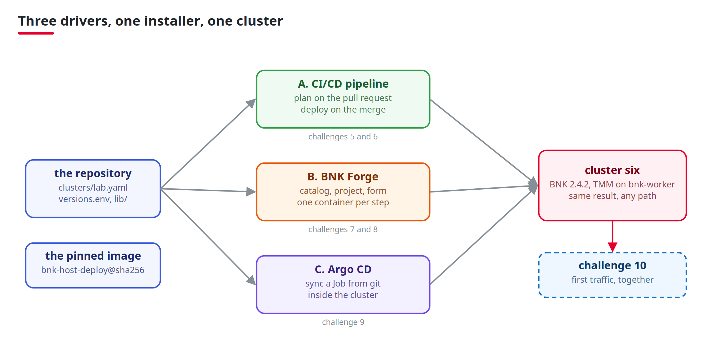
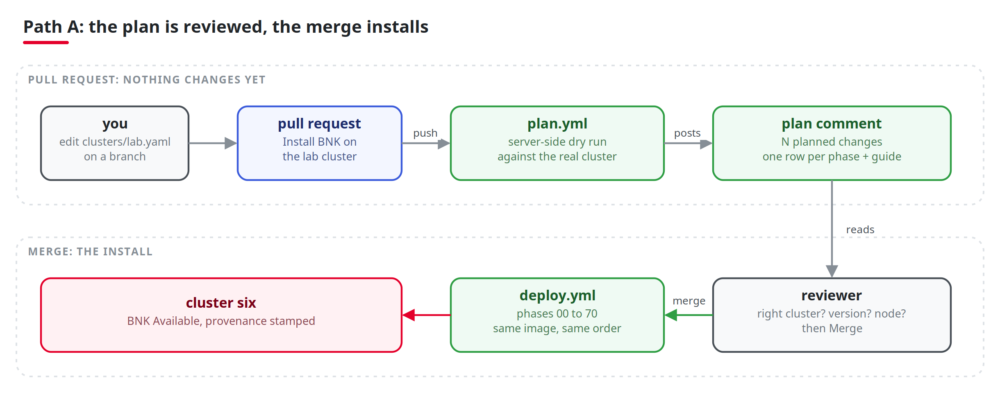

# Path A, Monday 14:00: say it in a pull request, read the plan

> **Path A, CI/CD.** On path B or C? Press **Skip** until you reach challenge 7 (Forge) or 9 (Argo CD).

In this path **you never run the installer yourself**. You describe what you want in git, and the
pipeline does the rest. Before it does anything, it shows you a plan.



Path A, end to end:



---

## Step 1: Hand the pipeline its credentials

Installing BNK takes two secrets:

| Secret | What it is | Who uses it |
|---|---|---|
| `FAR_PULL_B64` | the **F5 Artifact Registry** (FAR) service-account key | Helm, to pull F5's charts from `repo.f5.com`, and every node, to pull BNK's private images |
| `BNK_LICENSE_JWT` | the **licence**, a signed token | the `License` object BNK checks with F5 |

At Northwind both live in a vault. In this lab the vault is a Kubernetes Secret in the `lab-vault`
namespace, standing in for HashiCorp Vault or a cloud secret manager. Copy them into the
repository's Actions secrets:

```run
lab ci-secrets
```

The values travel from the vault straight into Gitea through its API. They never appear on your
screen or on disk, and Gitea will never show them again, because Actions secrets are
**write-only**. Look in **Gitea > platform/bnk-host-deploy > Settings > Actions > Secrets**: two
names, no values.

> ### Concept: why a pipeline gets secrets and a person does not
> A person who holds the licence file can install BNK anywhere, in any way, and nobody knows. A
> pipeline that holds it can only run the steps in this repository, and every run leaves a log. Move
> the secret from people to the pipeline and you move the trust from *who* to *what was reviewed*.

The command also set the repository variable **`BNK_INSTALLER=pipeline`**.

> ### Concept: one owner per cluster
> This repository works with three install tools. If two of them acted on the same merge, they would
> race each other on the same cluster. So the repository names an owner. `plan.yml`, `deploy.yml`
> and `apps.yml` act only when `BNK_INSTALLER` is `pipeline`. Forge and Argo CD set it to their own
> name when you choose them. Check it any time with `lab owner`.

---

## Step 2: Declare the cluster

Start a branch for the change:

```run
cd /root/workspace/bnk-host-deploy && git checkout -q main && git pull -q && git checkout -b enable-lab-cluster
```

Open `clusters/lab.yaml` in **VS Code** and make two edits:

1. **Choose the node that runs TMM.** Change `nodes: []` to

   ```yaml
     nodes: [bnk-worker]
   ```

   `bnk-worker` is the node Sam cabled to the edge router this morning, the one with the two extra
   NICs.

2. **Switch it on.** Change `enabled: false` to `enabled: true`.

Save with `Ctrl+S`. Before you commit, run the same validator that CI runs on every pull request:

```run
./tests/cluster.sh clusters/lab.yaml
```

You should see `ok clusters/lab.yaml env=lab enabled=true tmm=bnk-worker`.

Now make a mistake on purpose. Put two nodes in the list, `[bnk-worker, bnk-worker2]`, save, run the
test again and read the error. Then put it back to `[bnk-worker]`. A mistake caught here costs
seconds. The same mistake caught on a cluster costs an afternoon.

> ### What else the file declares (read it, do not change it)
> - `tmm.networks: [external-net, internal-net]`: TMM's two legs, which become interfaces **1.1** and
>   **1.2**, defined in `clusters/lab.attachments.yaml`
> - `legacy_network_model: true`: TMM's VLANs come from `F5SPKVlan` objects and its VIPs from an
>   `F5BnkGateway` address pool, both in `clusters/lab.network.yaml`
> - `pseudo_cni_exclude`: address ranges BNK must never steer through TMM (the Kubernetes service
>   range, the node network, the VIP pool), so ordinary cluster traffic is left alone

---

## Step 3: Commit, push, open the pull request

```run
git commit -am "clusters/lab: install BNK, TMM on bnk-worker" && git push -u origin enable-lab-cluster
```

The push prints a link: *Create a new pull request for 'enable-lab-cluster'*. In the **Gitea** tab,
open **Pull Requests > New Pull Request**, choose `enable-lab-cluster` into `main`, and title it
*Install BNK on the lab cluster*.

Two workflows start straight away:

| Workflow | Why it started |
|---|---|
| `ci` | every pull request gets the static checks: lint, render, cluster files, Forge manifests |
| **`plan`** | this change touches `clusters/`, which can change a cluster |

---

## Step 4: Watch the plan think

Open **Actions** and click the running `plan` job. It works in three steps.

**1. Which clusters does this change affect?** `ci/targets.sh` compares your branch with `main`. You
changed `clusters/lab.yaml`, so the answer is that one cluster and no other. Had you changed
`versions.env`, the answer would be *every enabled cluster*, because a version bump affects them
all.

**2. Plan each cluster.** It runs `./install.sh --cluster clusters/lab.yaml --plan`. Every phase prints
the page of F5's guide it automates, then what it *would* do:

- **preflight** checks the API server, Kubernetes 1.35, the CNI (Calico), CPU and storage
- `plan: would label bnk-worker with app=f5-tmm`
- `the FAR key logs in to repo.f5.com`. The plan proves the credential works **before** anyone
  approves an install that depends on it
- `plan: would helm install f5-lifecycle-operator v2.30.0-0.11.4`
- the **rendered CNEInstance**, the exact object the install will hand to F5's operator

**3. Post the plan on the pull request.** The result lands as a comment, and every later push to the
branch updates that same comment instead of adding a new one.

> ### Concept: a plan that touches the real cluster and changes nothing
> Plan mode talks to the live API server. It **dry-runs** every object *server-side*, which means the
> API server runs its admission webhooks and CRD schemas against it exactly as it would for a real
> apply, and then throws it away. It logs in to F5's registry with the real key. It writes nothing.
>
> Compare that with a check that only reads YAML: it would happily approve an object that the cluster
> then rejects. A plan that asks the cluster is the difference between *"the file looks fine"* and
> *"the cluster accepts it"*.

---

## Step 5: Review it the way Priya will

Go back to the pull request's **Conversation** tab and read the plan comment. It opens with the
number of planned changes, about a dozen on an empty cluster, then a table with one row per phase,
each linked to its page in F5's guide.

As the reviewer, answer three questions before anyone approves:

1. **Right cluster, and only that one?** The comment names `lab` and nothing else.
2. **Right version?** `manifestVersion: "2.4.2"` in the rendered CNEInstance.
3. **Right place?** `would label bnk-worker`, and `networkAttachments: external-net, internal-net`.

Three yeses, and the pull request is ready.

**Do not merge yet.** In this repository the merge *is* the install. That is the next challenge, and
it deserves your full attention.

Press **Check**. It confirms the pull request exists and its plan succeeded.
