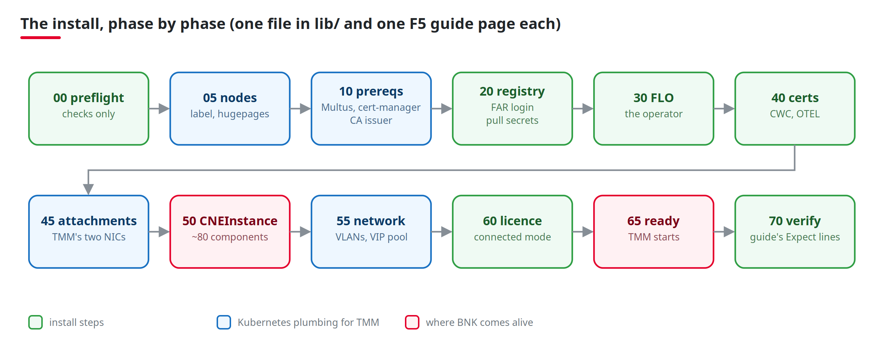

# Path A, Monday 14:30: the merge is the install

### The quietest button in the building

Priya reads the plan comment over your shoulder, checks the three answers, and approves.

*"Go on, then."*

You hover over **Merge**. On clusters one to five this moment was a two-hour screen-share, someone
reading the guide aloud and someone else typing. Here it is one click, and the click is the
approval. The pipeline will do exactly what the plan said, with the image you pinned, and write
down everything it did.

*"While it runs,"* Priya says, *"follow along. When the auditors ask what's on this cluster, I want
you to be able to name every pod."*

### What arrives, in order

```
 node prep ──▶ helpers ──▶ registry ──▶ operator ──▶ certificates ──▶ CNEInstance ──▶ network ──▶ licence ──▶ TMM
   05          10           20           30           40               50              55           60          65
```

Each number is one file in `lib/`, and one page of F5's guide. The order matters. The operator
needs the registry credentials to pull its charts. TMM needs a licence before the controller will
start it. The installer encodes that order once, so nobody has to remember it again.

---

> **Path A, CI/CD.** On path B or C? Press **Skip** until you reach challenge 7 (Forge) or 9 (Argo CD).

---

## Step 1: Merge

1. In **Gitea**, open **platform/bnk-host-deploy** and its **Actions** tab. Check that the `ci` and
   `plan` runs of your pull request both show a green tick. If one is still yellow, wait.
2. Open **Pull Requests**, then *Install BNK on the lab cluster*, and press **Merge**.
3. The merge starts the install. Go back to **Actions** and follow the `deploy` run below until it
   shows a green tick.

> Merged it already in challenge 5? Then the install has run, or is running. Open **Actions >
> deploy**, follow step 2 in that run's log instead of live, and carry on from step 3.

Open **Actions**. A `deploy` run has started on `main`. Click into it. A `ci` run starts too, because
every change to `main` is checked again.

> ### Concept: what woke the pipeline
> `deploy.yml` starts on a push to `main` that changes `clusters/**`, `environments/**`,
> `profiles/**`, `lib/**`, `versions.env` or `install.sh`. Its first step works out *which*
> clusters the merge affected, with `ci/targets.sh` between the previous and the new commit, and acts
> on those only. A merge that only edits documentation wakes nothing. A merge that bumps
> `versions.env` upgrades every enabled cluster, one after another, each one planned first.

---

## Step 2: Follow the phases, and see each one land

Keep the deploy log open, and in **Terminal 2** watch the namespaces fill up (`Ctrl+C` stops it):

```run
watch -n5 'kubectl get pods -A --no-headers | grep -vE "kube-system|calico|tigera|local-path" | awk "{print \$1}" | sort | uniq -c'
```

A cold install takes about **6 to 10 minutes**. Here is the whole journey:



And here is what each phase does, and why it exists.

**`00 preflight`.** Checks the tooling, the API server, Kubernetes 1.35, Calico, CPU and storage
*before* touching anything. Every failure caught here would otherwise surface twenty minutes later,
halfway through an install.

**`05 label the TMM node`.** `kubectl label node bnk-worker app=f5-tmm`, then proves the node offers
**hugepages**.

> ### Concept: hugepages
> Memory is handed out in pages, normally 4 KiB each. A process that touches gigabytes of memory
> spends real time just looking up where its pages are. **Hugepages** are 2 MiB pages: 512 times
> fewer lookups. TMM moves packets at line rate and wants its memory this way, so the node must
> reserve hugepages in advance, and Kubernetes advertises them like CPU and memory. No hugepages,
> no TMM.

**`10 cluster prerequisites`.** Three helpers arrive:

| Helper | Where | Why BNK needs it |
|---|---|---|
| **Multus** | `kube-system`, DaemonSet `kube-multus-ds` | gives a pod **more than one network interface**. TMM needs its two data legs on Sam's networks as well as its normal pod interface |
| **cert-manager** | `cert-manager` | issues TLS certificates and renews them before they expire, with nobody involved |
| a **CA chain** | `ClusterIssuer f5-cne-internal-ca` | the private certificate authority that signs every certificate BNK's components use to talk to each other |

> ### Concept: why BNK needs its own certificate authority
> BNK is a team of components: a controller, TMM, a state store, a licensing service, telemetry.
> They talk to each other over **mutual TLS**, where *both* sides show a certificate, so a
> component can trust that it is talking to the real controller and not to an impostor. Someone has
> to issue those certificates and keep renewing them. That is cert-manager's job, using the CA this
> phase creates.

> ### Concept: Multus and the CNI
> Your **CNI** (Calico here, challenge 1) gives every pod exactly one interface, `eth0`, on the pod
> network. That is perfect for apps and useless for a network function that must sit *on* specific
> wires. **Multus** is a "meta-CNI": it calls Calico for `eth0` as usual, then attaches extra
> interfaces described by `NetworkAttachmentDefinition` objects. Phase 45 creates those definitions.

**`20 registry`.** Logs Helm in to `repo.f5.com` and creates `far-pull-secret` in the `f5-cne-core`
and `f5-bnk` namespaces. Every BNK image is private. Without this secret, every pod would sit in
`ImagePullBackOff`.

**`30 lifecycle operator`.** `helm install f5-lifecycle-operator` into `f5-cne-core`. Watch the
`f5-lifecycle-operator` pod appear. The log then counts the new F5 resource types it registered.

> ### Concept: operators and CRDs
> Kubernetes knows Pods and Services out of the box. A **CRD** (custom resource definition) teaches
> it a new kind of object, such as `CNEInstance`. An **operator** is a program that watches those
> objects and does whatever it takes to make reality match them. You write ten lines saying *"BNK
> 2.4.2, size Small"*. The **F5 Lifecycle Operator (FLO)** reads F5's *release manifest*, the
> exact image and chart of every component in that release, and performs the hundreds of steps.

**`40 certificates`.** Runs F5's `f5-cert-gen` for the licensing service (CWC), then checks the files
really contain certificates. An earlier version of this installer once "succeeded" with empty ones.
The check exists because of that day.

**`45 attachments`.** Applies `clusters/lab.attachments.yaml`: `external-net` becomes TMM's interface
**1.1** on the node's `eth1`, and `internal-net` becomes **1.2** on `eth2`.

**`50 CNEInstance`.** The big one. The log reports *reconciling* while your watch shows `f5-bnk`
growing: the CNE controller, DSSM (BNK's state store, three replicas), the observer, CSRC (an agent
on every node), the certificate service and more.

**`55 network`.** Applies `clusters/lab.network.yaml` through F5's validation webhook: the VLANs
`external` (`10.10.10.11`) and `internal` (`172.18.0.250`), the VIP pool `10.30.30.10` to `.29`,
and the GatewayClass `f5-gateway-class`.

**`60 licence`.** Creates the `License` object. BNK checks it with F5 over the internet, which is
called **connected mode**, and its state turns `Active`.

**`65 wait for the data plane`.** Only now, licensed, does the controller start **TMM**. Watch `f5-tmm`
appear on `bnk-worker`. When it is up, the CNEInstance turns **Available**.

**`70 verify`.** Every *Expect:* line of F5's guide, as an assertion: FLO running, CRDs present, no crash
loops, no image pull errors, licence Active, GatewayClass accepted, VLANs programmed. Then the
installer writes down who installed what, from which commit, on the cluster itself. You will read
that record on Day 2.

---

## Step 3: See it from the outside

When `deploy` is green, look at the result three ways.

The **Lab Topology** tab: the TMM box and the BNK control plane turn green, with the version, the
licence and the GatewayClass filled in.

The cluster's own view, in the **Terminal**:

```run
kubectl -n f5-bnk get cneinstance f5-bnk-instance -o jsonpath='{range .status.conditions[*]}{.type}={.status}{"\n"}{end}'
```

Sixteen conditions, all `True`. Each one is a part of BNK the operator brought up and checked.

```run
kubectl -n f5-bnk get pods -l app=f5-tmm -o wide
lab status
```

TMM runs on `bnk-worker` with five containers ready, and the licence is `Active`, an evaluation
entitlement with its expiry date.

And the moment of truth, from Sam's router:

```run
docker exec edge-router ping -c2 10.10.10.11
```

This morning nothing owned that address. Now TMM does, through its interface on `bnk-worker`'s
`eth1`.

---

## Step 4: Look inside TMM

Read that ping's replies again. One echo, **two replies**: the first with `ttl=255`, then a `DUP!`
with `ttl=64`. Two different things answered. Find out who:

```run
kubectl -n f5-bnk exec "$(kubectl -n f5-bnk get pod -l app=f5-tmm -o name | head -1)" -c f5-tmm -- ip -br addr
```

| Interface | What it is |
|---|---|
| `xeth0` | the pod's ordinary Calico interface, the one every pod gets. TMM takes it over too, so Linux renames it and shows it without an address |
| `eth0` | a Linux **mirror** of that pod interface, carrying the pod's IP (`/32`) |
| `net1`, `net2` | the two **Multus** interfaces from phase 45, on the node's `eth1` and `eth2`. TMM's data plane takes them over, so Linux shows them without an address |
| `external` `10.10.10.11/24`, `internal` `172.18.0.250/16` | Linux **mirrors** of TMM's two VLANs, carrying the same self IPs |
| `tmm`, `tmm_bp`, `lo` | private channels between TMM and the pod's Linux side, and loopback |

The middle column is each interface's state. `UP` means the kernel sees a link, which it can for the
real veth and macvlan cables (`xeth0`, `net1`, `net2`). TMM's mirror interfaces show **`UNKNOWN`**:
they are virtual devices TMM feeds itself, with no physical link to report, just like `lo` on any
Linux machine. They work perfectly well, as the ping's second reply is about to show.

This is the split every BIG-IP has had for twenty years. **TMM owns the wire.** It receives on `net1`,
`net2` and `xeth0`, and it answers with BIG-IP's TTL of 255. The pod's **Linux side** holds the same self
IPs on the mirror interfaces, so ordinary Linux programs can speak on those networks too. The most
important of those programs is the routing daemon, which lets BNK peer BGP with routers like Sam's
when dynamic routing is switched on. TMM passes some traffic up to Linux, Linux answers the ping as
well with TTL 64, and you see a duplicate. Harmless for a ping, and invisible for VIP traffic, which
belongs to TMM alone.

### Ask TMM itself: the debug sidecar

Linux's view of the pod is only half the story. TMM keeps its own route table, ARP table and
statistics, and BNK ships a **debug sidecar** next to it to read them. List the TMM pod's containers:

```run
T=$(kubectl -n f5-bnk get pod -l app=f5-tmm -o name | head -1)
kubectl -n f5-bnk get $T -o jsonpath='{.spec.containers[*].name}{"\n"}'
```

`f5-tmm` is TMM itself, and **`debug`** carries F5's tools: `bdt_cli` for TMM's networking tables,
`tmctl` for its statistics, plus `tcpdump`, `ping` and `traceroute` that run *as TMM*. Ask TMM for
its routes:

```run
kubectl -n f5-bnk exec $T -c debug -- bdt_cli -u -s tmm0:8850 route | grep 'isIpv6:false'
```

| Route | Interface | Meaning |
|---|---|---|
| `10.10.10.0/24` | `external` | Sam's network, from the `external` VLAN's self IP |
| `172.18.0.0/16` | `internal` | the node network, from the `internal` VLAN's self IP |
| `0.0.0.0/0` via `169.254.1.1` | `eth0` | the default route every Calico pod gets |
| `169.254.0.0/24`, `127.20.0.0/16` | `tmm`, `tmm_bp` | TMM's private channels to its Linux side |

Look for the client's network, `10.20.20.0/24`. It is **not there**. So how will TMM answer a user
behind Sam's router? BIG-IP remembers the router a connection arrived through and sends the replies
back the same way, a feature called **auto last hop**. It is also why the installer switched off
TMM's `arp.verifyreturnroute` check in phase 65: without that, TMM would refuse traffic it has no
return route for.

Now TMM's ARP table, filtered to IPv4:

```run
kubectl -n f5-bnk exec $T -c debug -- bdt_cli -u -s tmm0:8850 arp | grep -v 'fe80\|fc00'
```

Its own self IPs, `10.10.10.11` and `172.18.0.250`, are `permanent` entries. Sam's router,
`10.10.10.254`, may also be there as `resolved`: TMM learns neighbours from the ARP requests it
receives, so whether it shows depends on timing. It is not needed for the replies, though. The route
table proved that: auto last hop sends them back the way they came.

Finally, TMM's own load:

```run
kubectl -n f5-bnk exec $T -c debug -- tmctl -d blade tmm_stat -s cpu_usage_5secs,memory_used,client_side_traffic.tot_conns
```

One row per **TMM thread**, four here. The CPU column is far from zero even with no traffic, and
that is normal. TMM **polls** its interfaces in a tight loop instead of waiting for the kernel to
interrupt it, which is how it moves packets at line rate. You will come back to `tmctl` in
challenge 10, when there is traffic to count.

> ### Concept: two network stacks in one pod
> `ip addr` showed you Linux's view, `bdt_cli` shows you TMM's. They share the self IPs but keep
> separate routes, ARP tables and counters. When traffic misbehaves, check both: a route Linux has
> but TMM lacks (or the reverse) is the classic cause. F5's troubleshooting guide for BNK starts
> exactly here, with the TMM logs and this debug sidecar.

---

## Step 5: Prove it repeats safely

Run the deploy again, on purpose. In **Gitea > Actions**, select the `deploy` workflow and press
**Run workflow**. Leave the cluster field empty to target every enabled cluster.

This time every phase reports *already present* or *already installed*, and the run is quick.

> ### Concept: convergence (idempotency)
> An installer that only works on an empty cluster is a script. One that brings any cluster to the
> declared state, and does nothing when the cluster is already there, is a **converging** installer.
> Convergence is what makes it safe to run from a pipeline as often as you like: after a failure,
> after a node replacement, or every night just to prove nothing has drifted.

Press **Check**. It confirms the deploy succeeded and BNK is Available.
