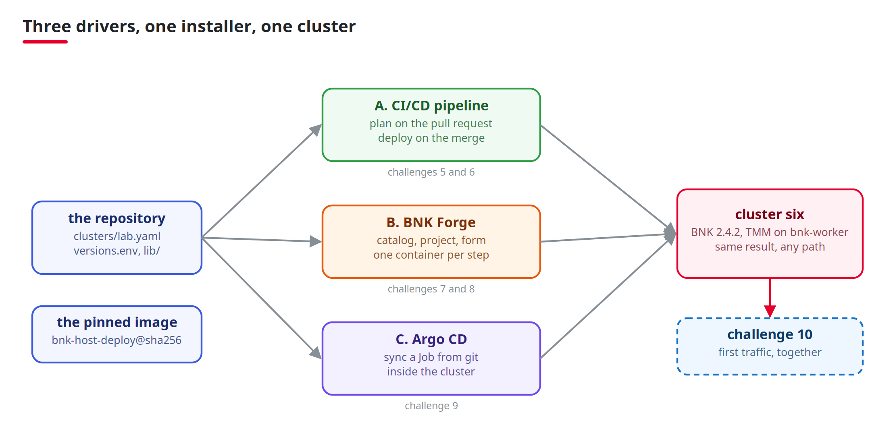
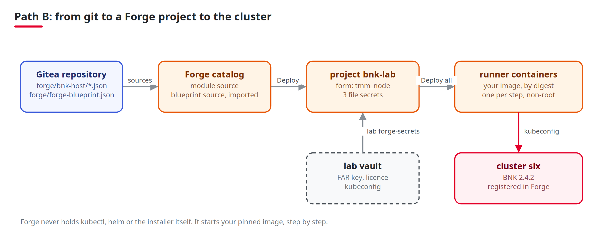
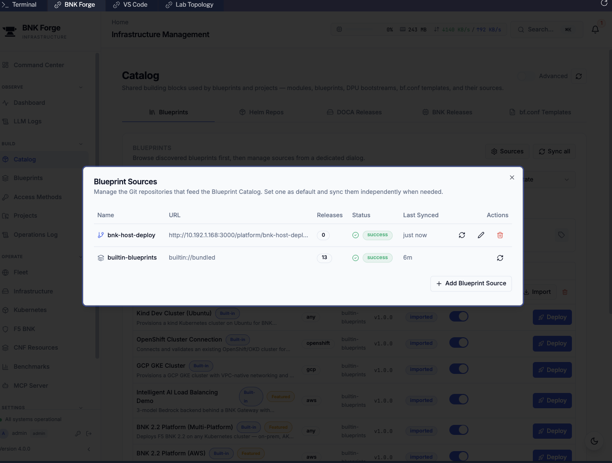
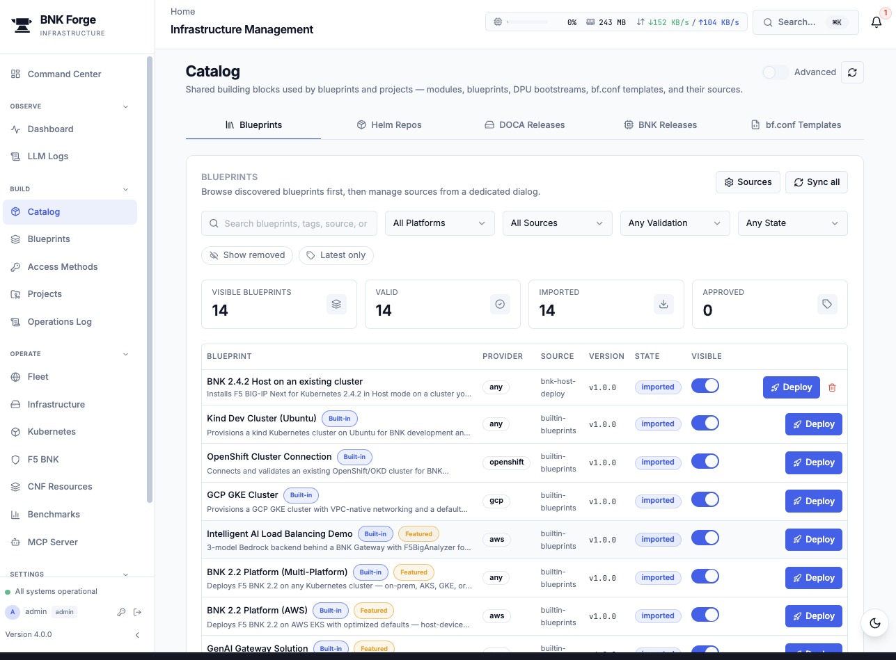
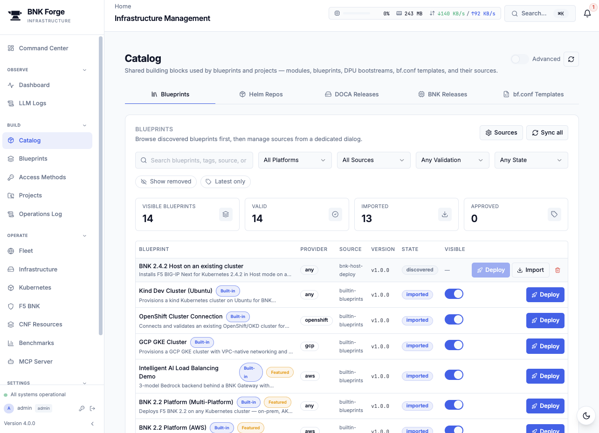
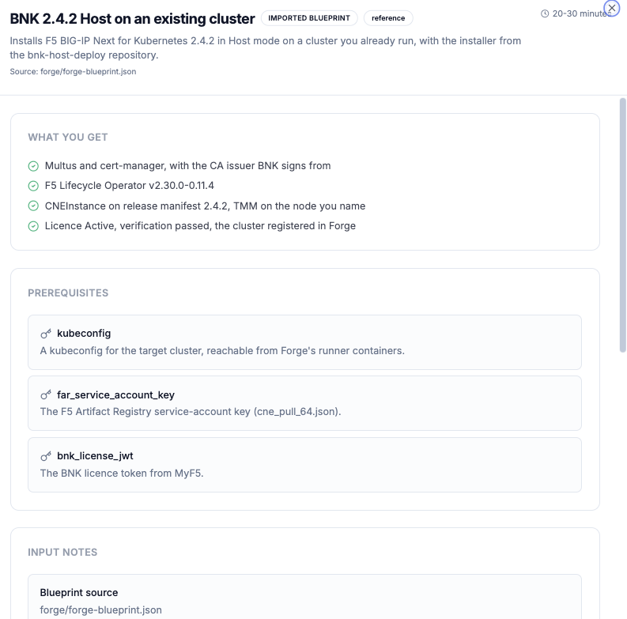
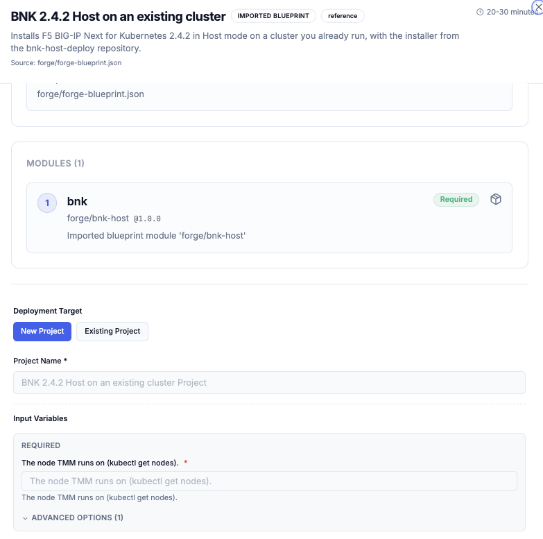
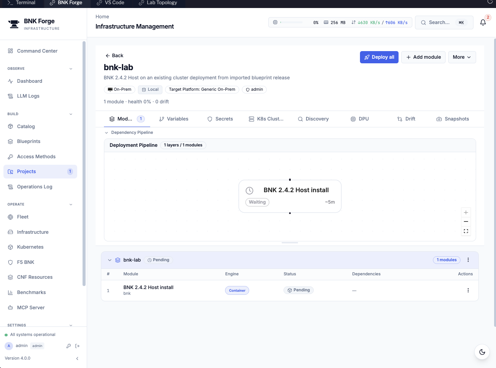
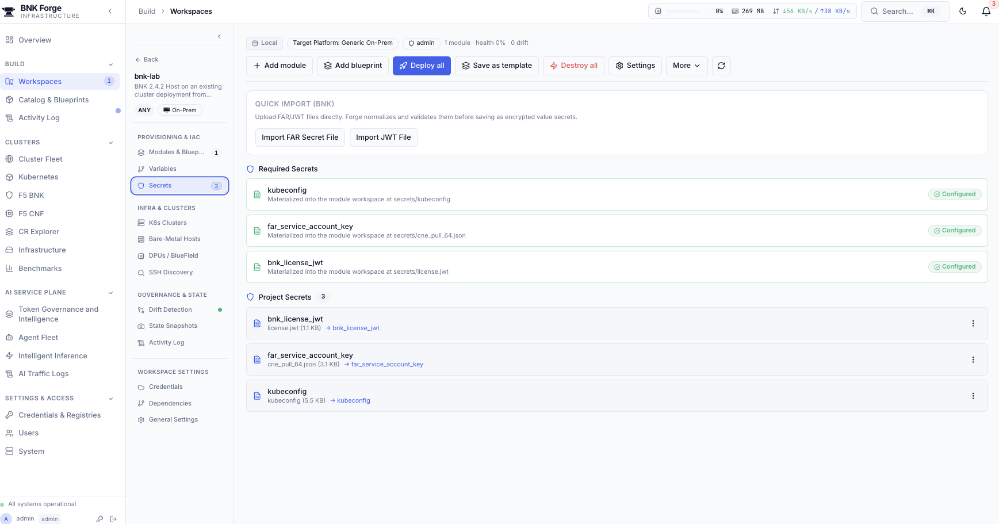

# Path B, Monday 14:00: teach BNK Forge your installer

### Why a platform team likes Forge

The pipeline is perfect for people who live in git. Northwind's operations desk does not. They
want to *see* an install: which step is running, which one failed and why, and a **Retry** button
that starts from the failed step, not from the beginning.

**BNK Forge** is F5's platform tool for BIG-IP Next for Kubernetes. It installs BNK from
**modules** (packaged installers) and **blueprints** (recipes that combine modules with a form), and
it keeps watching the clusters it knows: versions, health, gateways, drift. Today you teach it to
run *your* installer, the exact image you pinned this morning.

---

> **Path B, BNK Forge.** On path A? You can **Skip** this and challenge 8. On path C? Press **Skip**
> until challenge 9.

Here is where everything you will touch sits:



Path B, end to end:



---

## Step 1: Install Forge

Forge ships as a set of containers. Its Linux install is: take the release bundle, write an `.env`
file, run the bundle's `install.sh`. This does exactly that and explains as it goes:

```run
lab forge
```

What you get, all on this VM:

| Container | Its job |
|---|---|
| `bnk-forge-backend` | the REST API that the UI, the CLI and the MCP server all use |
| `bnk-forge-celery-worker`, `-2`, `-beat` | the engine: runs deployment steps and scheduled health checks |
| `bnk-forge-frontend`, `bnk-forge-proxy` | the web UI, behind a TLS proxy on port **8443** |
| `bnk-forge-postgres`, `bnk-forge-redis` | Forge's database and its task queue |
| `bnk-forge-docker-socket-proxy` | a **narrowed** view of Docker. Forge starts module containers through it, never through the raw Docker socket |
| `bnk-forge-mcp` | an MCP server, so AI assistants can drive Forge too |

Three settings the command made, and why:

- **a strong database password** for this sandbox, set before first start, because Postgres bakes it
  in at initialisation
- **the admin password changed**, because Forge forces that at first login
- **`localhost:5000` allowed as a registry**. Forge runs module images only from registries an admin
  has allowed, and only when they are pinned by digest

It also set the repository variable `BNK_INSTALLER=forge`, so the CI pipeline now stands aside for
this cluster. Run `lab owner` whenever you want to check.

Open the **BNK Forge** tab and sign in as `admin` with the password the command printed (it is also
in `/root/.lab/forge-password`).

---

## Step 2: Read the module before you load it

In **VS Code**, open `forge/bnk-host/bnkforge.artifact.json`. This is the contract between your
installer and Forge, and Forge enforces every line of it:

| Block | What it says |
|---|---|
| `container_image` | registry `localhost:5000`, the repository, and the **digest** you pinned. A tag would be rejected |
| `steps.apply` | ten steps, each one `["bnk-host", "<phase>"]`. Plain argument lists, no shell. Forge refuses `sh -c` |
| `secret_files` | three secrets Forge writes into the runner's `/work/secrets`, mode 0600: `kubeconfig`, `far_service_account_key`, `bnk_license_jwt` |
| `inputs` | the deploy form. `tmm_node` is required, the rest has defaults |
| `cluster` | after a successful install, register the cluster on Forge's **Kubernetes** page |

> ### Concept: why Forge insists on a digest
> A container image **tag** such as `:2.4.2` is a label, and labels can be moved to a different image
> at any time. A **digest** (`sha256:…`) is the fingerprint of the image's content, so it can never
> point at anything else. Forge only runs digests. When Jonas from audit asks *"what exactly ran on
> cluster six?"*, the answer is one fingerprint, and it is the one in git.

> ### Concept: the form is the cluster file
> `tmm_node` in Forge's form and `tmm.nodes` in `clusters/lab.yaml` are the same setting. The runner
> starts from the repository's `clusters/lab.yaml` and its network files, then sets the node you
> type. Git or Forge, the cluster ends up described the same way.

---

## Step 3: Load the repository into Forge's catalog

Forge learns about modules and blueprints from **sources**: git repositories it clones and checks.
Your repository is both kinds of source. Add them and import the blueprint through Forge's API:

```run
lab forge-catalog
```

Three blocks, each one a thing you could also click in the UI:

1. **module source**. Forge clones the repository, finds `forge/bnk-host/bnkforge.pack.json`,
   validates it (pinned digest, allowed registry, argument-list steps, non-root image) and lists
   the module **BNK 2.4.2 Host install**
2. **blueprint source**. The same URL, read for `forge/forge-blueprint.json`. The blueprint **BNK
   2.4.2 Host on an existing cluster** appears
3. **import**. The blueprint moves from *discovered* to *imported*

Now look at the result in the UI. In **BNK Forge**, open **Build > Catalog**, stay on the
**Blueprints** tab, and press **Sources**. Your repository sits next to Forge's built-in blueprints:



Close the dialog. Your blueprint is at the top of the list, **imported**, with **Deploy** enabled:



> ### Concept: discovered, imported, immutable
> **Discovered** means *Forge has seen this blueprint in a source*. **Imported** means *an admin has
> accepted it, and it may be deployed*. Before the import the row looks like this, with Deploy
> greyed out:
>
> 
>
> Each imported version is a **release**, and releases are immutable. Change the blueprint or the
> module and you must give it a new version number. Nobody can quietly swap what *v1.0.0* means.

---

## Step 4: Create the project

Press **Deploy** on *BNK 2.4.2 Host on an existing cluster*. Forge shows what the blueprint
promises, what it needs, and which module it runs:



Every word of that page came from `forge/forge-blueprint.json` in your repository. Scroll down:



1. **Deployment Target:** keep **New Project**, and set **Project Name** to `bnk-lab`
2. **The node TMM runs on:** `bnk-worker`. Careful, this field sits right under *Project Name*: the
   node is `bnk-worker`, the project is `bnk-lab`. If they get swapped, the first install step says so
3. Leave **Advanced options** alone. `cluster_name` defaults to `lab`
4. Press the button at the bottom of the dialog

Forge creates the project and waits. In Forge, **Deploy** on a blueprint means *create the deployment*,
and **Deploy all** on the project, in the next challenge, means *run it*. The module is **Pending** and the pipeline says **Waiting**,
because the three secrets the blueprint needs are not there yet:



> ### Concept: a project
> A Forge **project** is one deployment: which modules, which inputs, which secrets, which cluster,
> and the history of every run. Make a second project with another `tmm_node` and you have a second,
> independent install recipe, in the same Forge.

---

## Step 5: Attach the credentials, without seeing them

The project needs the three secrets the module declared. They live in the lab vault, and the values
never reach your screen:

```run
lab forge-secrets bnk-lab
```

Each one is uploaded as a **file secret**, exactly what the UI's **Add File** button creates. Forge
stores it encrypted and writes it, mode 0600, into the runner container at
`/work/secrets/kubeconfig`, `/work/secrets/cne_pull_64.json` and `/work/secrets/license.jwt`, only
for the length of a run. The last block of the output lists each required secret as **present**.

Open the project's **Secrets** tab. Under **Required Secrets**, all three rows now say **Configured**.
Under **Project Secrets**, each file is listed with an arrow to the requirement it satisfies, for
example `license.jwt → bnk_license_jwt`. That link is what tells Forge *this* file is *that*
credential. The values themselves are never shown.



> ### Concept: why the kubeconfig is a secret here
> The CI runner lives beside the cluster with its own access. Forge's runner is a short-lived
> container that Forge starts on demand, and the *only* way it can reach the cluster is the
> project's `kubeconfig` secret. That is also why this lab's API server listens on the VM's address
> rather than on `127.0.0.1`: so those containers can reach it.

Press **Check**. It confirms Forge is running, the blueprint is imported and project `bnk-lab` holds
its three secrets.
