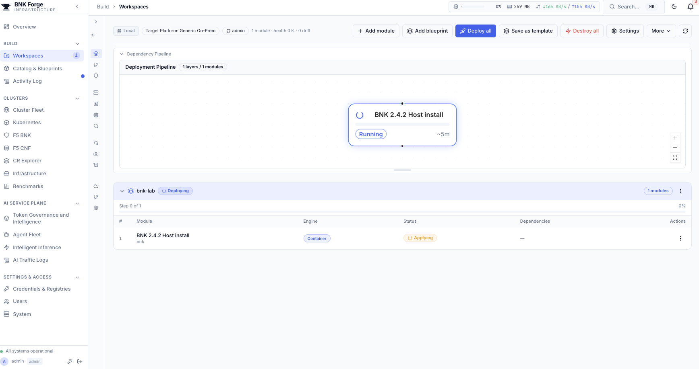
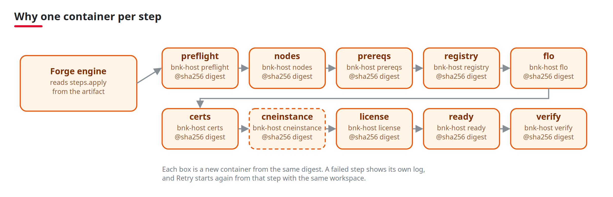
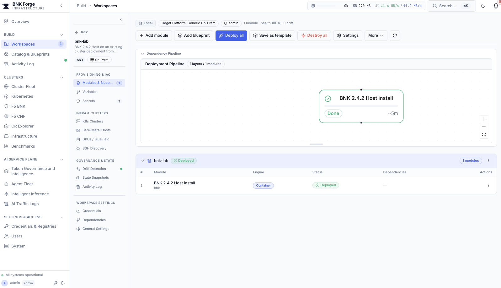
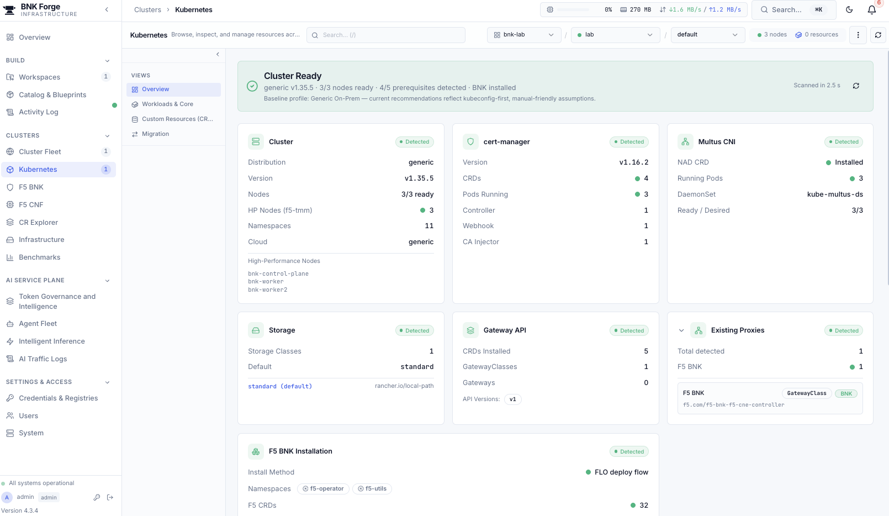
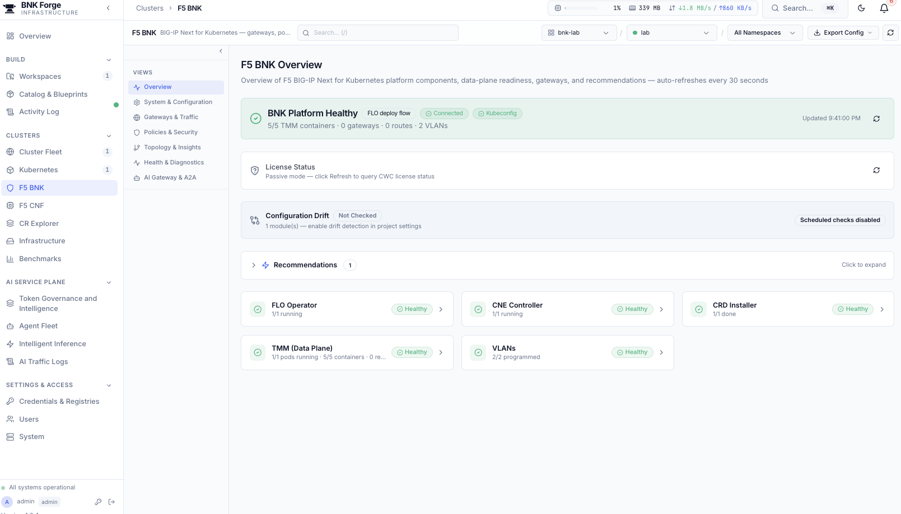
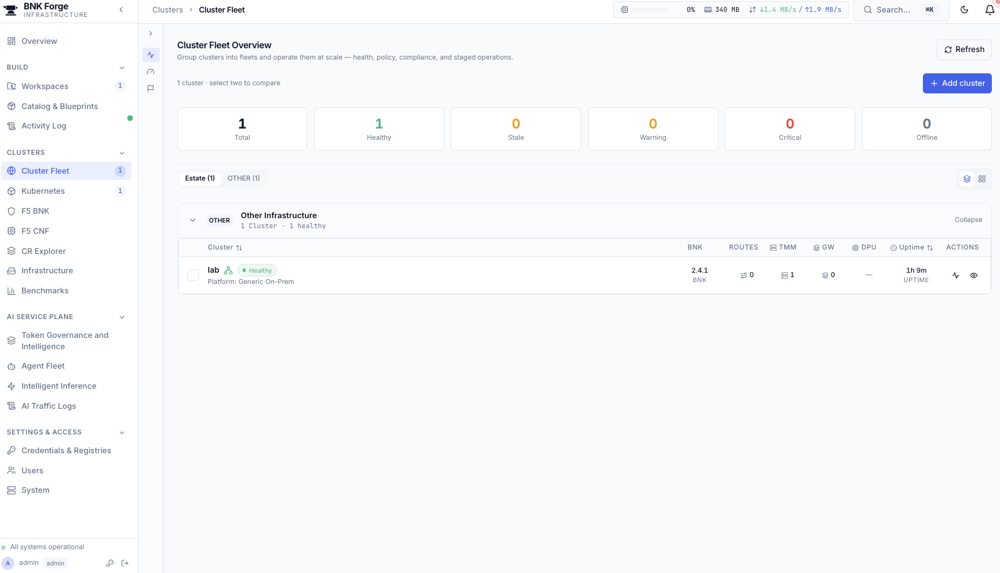

# Path B, Monday 14:45: press Deploy, watch ten steps

### A different kind of audience

Northwind's operations desk gathers behind your chair. They have never opened the repository, and
they never will. What they want is the thing on your screen now: a project page, a big **Deploy
all** button, and a promise that they will see every step as it happens.

*"If something breaks at step six,"* asks Ana from the night shift, *"do I start again from the
beginning?"*

*"No,"* says Priya. *"You read step six's log, fix the cause, and press Retry. Forge picks up from
there."*

### Same installer, different window

Nothing about the install changes on this path. The same ten phases run, in the same order, from
the same image digest you pinned in challenge 4. What changes is the *window* you watch them
through:

| | Path A, pipeline | Path B, Forge |
|---|---|---|
| started by | a merge | a button |
| one run is | one job, one log | ten containers, ten logs |
| a failure | re-run the workflow | **Retry** from the failed step |
| who watches | the engineers in git | anyone with a Forge login |

---

> **Path B, BNK Forge.** On path A? You can **Skip** this challenge. On path C? Press **Skip** until
> challenge 9.

---

## Step 1: Deploy

In **BNK Forge**, open **Build > Workspaces**. Workspace **bnk-lab** holds one module, *BNK 2.4.2
Host install*, engine **Container**.

Press **Deploy all** (top right). The workspace turns to **Deploying**, the module to **Applying**,
and the Deployment Pipeline box above shows the module **Running**:



---

## Step 2: Follow the steps

Click the module to open its log. Each step appears as it starts:

| Forge step | What it does in the cluster | F5 guide page |
|---|---|---|
| `preflight` | API server reachable *from the runner container*, Calico, CPU, storage | System requirements |
| `nodes` | label `app=f5-tmm` on `bnk-worker`, hugepages proven | Label TMM nodes |
| `prereqs` | Multus, cert-manager, the CA issuer | Install cert-manager |
| `registry` | Helm login to `repo.f5.com`, `far-pull-secret` in two namespaces | Pull secret for FAR |
| `flo` | `helm install f5-lifecycle-operator` | Install FLO |
| `certs` | `f5-cert-gen`, certificates checked non-empty | Prepare the CNE core |
| `cneinstance` | the operator lays down about 80 components | Install a CNE instance |
| `license` | the `License` object, checked with F5 | License your cluster |
| `ready` | TMM starts on `bnk-worker`, CNEInstance Available | |
| `verify` | every *Expect:* line of the guide, then provenance | |

Every step's log starts the same way:

```
Image user: 1000 (non-root ✓)
$ docker run localhost:5000/bnk-host-deploy@sha256:… bnk-host preflight
```

Forge checked that the image runs as an ordinary user, never root, and then started a **new
container** for this one step, from the exact digest in git.



While it runs, watch the containers come and go in **Terminal 2**. Each line is one step (`Ctrl+C`
stops it):

```run
watch -n3 "docker ps --filter ancestor=$(docker images --format '{{.Repository}}:{{.Tag}}' | grep bnk-host-deploy | head -1) --format 'table {{.Names}}\t{{.Command}}\t{{.Status}}'"
```

And the cluster filling up, in the **Terminal**:

```run
kubectl get pods -A --no-headers | grep -vE 'kube-system|calico|tigera|local-path' | awk '{print $1}' | sort | uniq -c
```

A cold install takes about **6 to 10 minutes**. The workspace's Deployment Pipeline turns to **Done**:



> ### Concept: why one container per step
> If step `cneinstance` fails, Forge shows *that* step's log, and **Retry** runs again from there,
> with the same workspace. The earlier steps are not repeated blindly. Each step runs the exact
> digest the module pinned, so a retry next week runs exactly the same code. And Forge itself never
> needs kubectl, helm or the installer on its own servers. Everything it runs comes in your image.

---

## Step 3: The cluster through Forge's eyes

The module's `cluster` block told Forge to register the cluster it just installed. Open **Clusters >
Kubernetes** and pick workspace `bnk-lab` and cluster `lab` in the selectors at the top:



Forge scanned the cluster in under two seconds and found everything BNK depends on: three nodes,
cert-manager, Multus on every node, storage, the Gateway API, and BNK itself.

Now open **Clusters > F5 BNK**. It opens on **Overview**:



**BNK Platform Healthy.** Five of five TMM containers, both VLANs programmed, and the operator, the
controller and the CRD installer all green. Zero gateways for now. You will add the first one in
challenge 10.

> The **License Status** card is in *passive mode*: Forge does not ask F5's licensing service on
> its own. Press the card's refresh button to make it ask. The cluster itself knows the answer
> already, and you will check it from the terminal in a moment.

One more view. **Clusters > Cluster Fleet** is where an operations team with many clusters starts
the day. Yours has one, **lab**, and it is **Healthy**:



> Look at the **BNK** column: it says **2.4.1**. That is Forge's label, not your cluster's. The
> release that runs is whatever the CNEInstance names, and the terminal check below prints
> **manifest 2.4.2**. When a dashboard and the cluster disagree, believe the cluster.

From the terminal, the same facts, plus who installed them:

```run
kubectl -n f5-bnk get cneinstance f5-bnk-instance -o json | jq '.metadata.annotations | with_entries(select(.key | startswith("bnk-host-deploy.io")))'
lab status
docker exec edge-router ping -c2 10.10.10.11
```

`orchestrator: forge`, actor `forge-runner`, the commit the image was built from, and the time. The
record lives on the object itself, not in someone's memory. `lab status` shows the licence
**Active**. And Sam's router now reaches TMM's external self IP, `10.10.10.11`.

---

## Step 4: How a new installer version reaches Forge (read)

Weeks from now, the team improves the installer. How does that change reach clusters that Forge
manages? Not by editing anything in Forge. It goes the way every change goes, through git:

1. a branch with the change, then `lab image`. A new build has a **new digest**, and `lab image`
   bumps the module's version, say from `1.0.0` to `1.0.1`, in the artifact, the pack and the
   blueprint together
2. a pull request, reviewed and **merged**. The `ci` workflow runs Forge's own validator on the new
   manifests
3. `lab forge-catalog`. Forge's sources follow `main`, so it now finds release **v1.0.1** and imports
   it
4. in workspace `bnk-lab`, on the module's **⋮** menu, **Change Version** to `1.0.1`, then **Deploy all**

> ### Concept: why a new digest needs a new version
> Forge treats a released version as **immutable**. Publish different content under the same
> version and Forge refuses it as a conflict. That is a feature. *"Cluster six runs module 1.0.1"*
> must mean the same bytes today and in a year. Two rules travel together: a new build means a new
> digest, and a new digest means a new version.

Press **Check**. It confirms the Forge deployment succeeded and BNK is Available.
