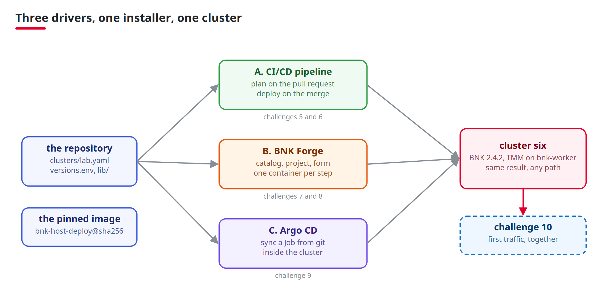
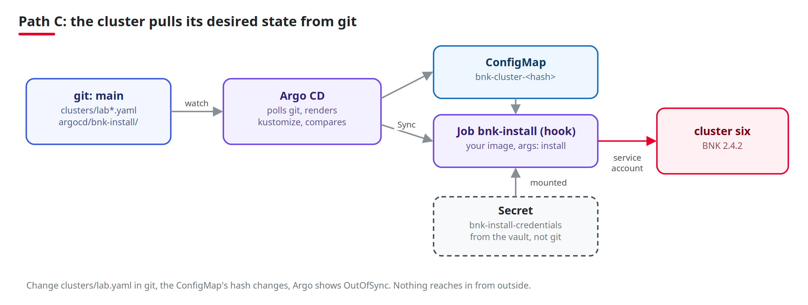
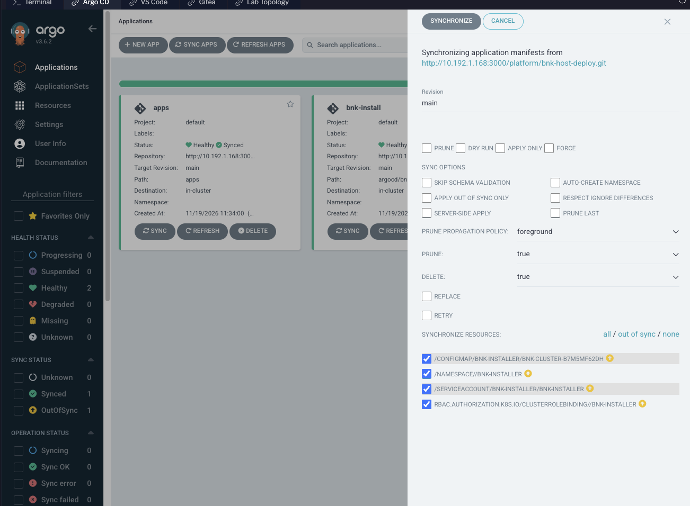
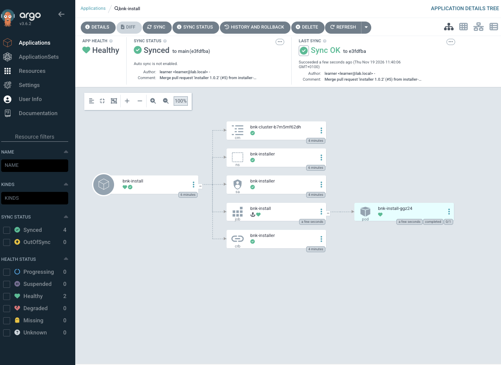
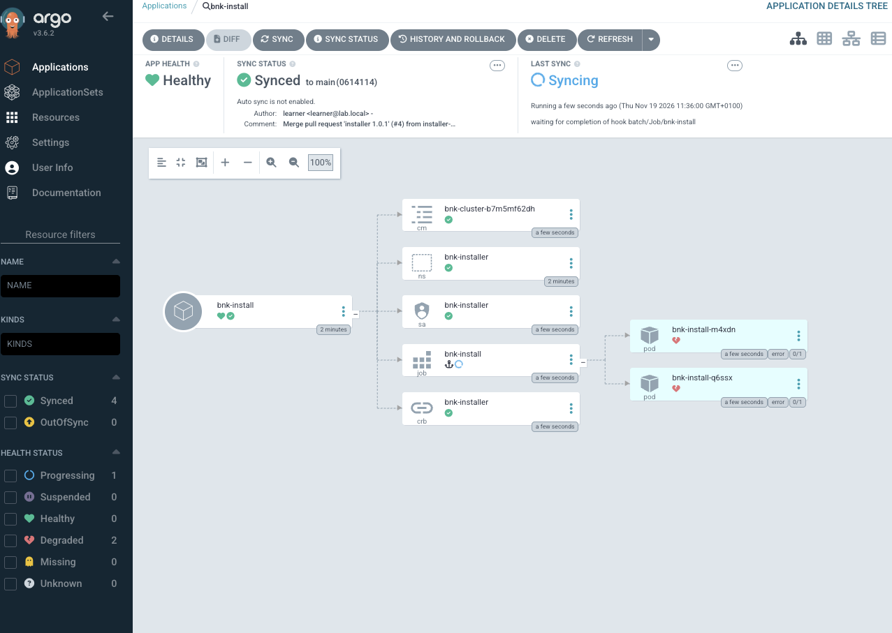

# Path C, Monday 14:00: let the cluster pull its own install

> **Path C, Argo CD.** On path A or B? BNK is already installed. Press **Skip** to go to challenge 10.



Path C, end to end:



---

## Step 1: Read what Argo will apply

In **VS Code**, open the folder `argocd/bnk-install/`:

| File | What it is |
|---|---|
| `kustomization.yaml` | the list Argo renders. Its `configMapGenerator` takes **`clusters/lab.yaml` and its two network files straight from the repository** and turns them into a ConfigMap |
| `namespace.yaml`, `rbac.yaml` | a namespace `bnk-installer`, and a service account with the rights the installer needs |
| `job.yaml` | a Kubernetes **Job** that runs your digest-pinned image with `args: ["install"]`, the ConfigMap mounted at `/config` and the credentials Secret at `/work/secrets` |

> ### Concept: a Job, and a sync hook
> A **Deployment** keeps pods running forever. A **Job** runs a pod until it *finishes*, which is
> exactly what an install is. The annotation `argocd.argoproj.io/hook: Sync` makes it a **sync
> hook**: every time you sync, Argo deletes the previous Job, creates a fresh one, waits for it to
> complete, and shows its log. Argo does not try to keep the Job "in sync" like the other objects,
> it simply runs it.

> ### Concept: why the ConfigMap name has a hash
> Kustomize names a generated ConfigMap after its content, for example `bnk-cluster-b7m5mf62dh`.
> Change `clusters/lab.yaml` in git and the name changes, so the Job changes, so Argo reports the
> application **OutOfSync**. The cluster's desired state flows from the same file the pipeline path
> uses. One source of truth, whichever tool applies it.

---

## Step 2: Install Argo CD

```run
lab argocd
```

What it does, in five blocks:

1. applies Argo CD's own install manifest, pinned to v3.6.2, into the namespace `argocd`
2. tells Argo to serve plain HTTP behind the tab, to poll git every minute, and to let kustomize read
   `clusters/` from the repository root. Then it restarts Argo's components and waits for them. The
   first start pulls their images, so this block takes **1 to 3 minutes**
3. creates the Secret `bnk-installer/bnk-install-credentials` from the lab vault: the FAR key and the
   licence, **never in git**. In production this is External Secrets or Sealed Secrets
4. creates two Applications, both pointing at your Gitea repository
5. opens the UI on the **Argo CD** tab, and sets `BNK_INSTALLER=argocd` so the pipeline stands aside

Open the **Argo CD** tab and log in as `admin` with the password the command printed.

| Application | Watches | Sync | Right now |
|---|---|---|---|
| `bnk-install` | `argocd/bnk-install/` | **manual**, because installing BNK is a decision | **OutOfSync** |
| `apps` | `apps/` | **automatic**, with self-heal | **Synced**, and empty |

---

## Step 3: Declare the cluster in git

The repository still says `enabled: false`, with no TMM node. A Job started now would refuse to
install, and it would be right to. Change it the way every change goes in:

```run
cd /root/workspace/bnk-host-deploy && git checkout -q main && git pull -q && git checkout -b enable-lab-cluster
```

In **VS Code**, edit `clusters/lab.yaml`. Set the TMM node:

```yaml
  nodes: [bnk-worker]
```

and switch it on with `enabled: true`. Save, then validate, commit and push:

```run
./tests/cluster.sh clusters/lab.yaml && git commit -am "clusters/lab: install BNK, TMM on bnk-worker" && git push -u origin enable-lab-cluster
```

In **Gitea**, open the pull request and **merge** it. Notice that `plan` and `deploy` do not run. The
repository says Argo CD owns this cluster.

---

## Step 4: Sync

Back in **Argo CD**, open `bnk-install` and press **Refresh**. Argo reads the new commit, renders it,
and the ConfigMap's name changes, because the file changed. Press **Sync**:



The panel lists the **four objects** this sync creates: the generated ConfigMap, the namespace, the
service account and its permissions. The install Job is not in the list, because hooks are not
resources Argo keeps in sync. Argo runs it as part of the sync instead.

Keep the defaults (no Prune, no Force) and press **Synchronize**.

Argo applies the namespace first (sync wave `-2`), then the permissions (wave `-1`), then starts the
hook Job. Click the **Job**, then its **pod**, then **Logs**: the same installer output you would see
in the pipeline, phase by phase, each with its F5 guide page, streaming from a pod inside the
cluster. Or follow it in the **Terminal**:

```run
kubectl -n bnk-installer logs -f job/bnk-install
```

A cold install takes about **6 to 10 minutes**. When the Job completes, the application turns
**Synced**, and the last sync says **Sync OK**:



> ### Concept: the installer inside the cluster
> No kubeconfig left the cluster. The Job uses the pod's own **service account**: Kubernetes mounts
> a short-lived token into every pod, and RBAC (`rbac.yaml`) decides what that token may do. The
> only other credentials the Job holds are mounted from a Secret for the life of one pod. That is the
> GitOps security argument: the cluster reaches out to git, and nothing reaches in.
>
> One detail the team learned the hard way: `kubectl` inside a pod does **not** use that token on
> its own. Without a kubeconfig it tries `localhost:8080` and fails. The installer's entrypoint
> therefore writes a small kubeconfig that points at the token *file*, so it keeps working when the
> kubelet rotates the token.

> ### When a hook fails
> A failed hook looks like this: the Job keeps spinning, and its pods show a broken heart and
> `error`. Kubernetes retries once (`backoffLimit: 1`) and then gives up.
>
> 
>
> Click a failed pod, then **Logs**. The first `XX` line names the cause. Fix it in git, merge, and
> sync again. The hook policy deletes the failed Job before it creates the new one.

---

## Step 5: Confirm, and see who installed it

```run
kubectl -n f5-bnk get cneinstance f5-bnk-instance -o json | jq '{available: (.status.conditions[] | select(.type=="Available") | .status), stamp: (.metadata.annotations | with_entries(select(.key | startswith("bnk-host-deploy.io"))))}'
docker exec edge-router ping -c2 10.10.10.11
```

`available: True`, `orchestrator: argocd`, actor `argocd-runner`, and the commit the image was built
from. And TMM answers Sam's router on its external self IP.

The ping shows one reply and then a `DUP!` with a different TTL. Two things answered, TMM (TTL 255)
and the Linux side of the TMM pod (TTL 64), which holds the same address so routing software can use
it. Harmless for a ping, and invisible for VIP traffic.

Press **Check**. It confirms the install Job succeeded and BNK is Available.
