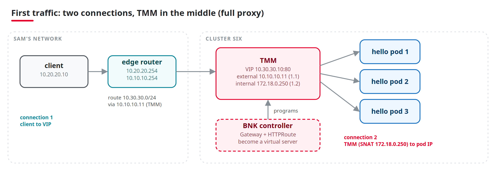
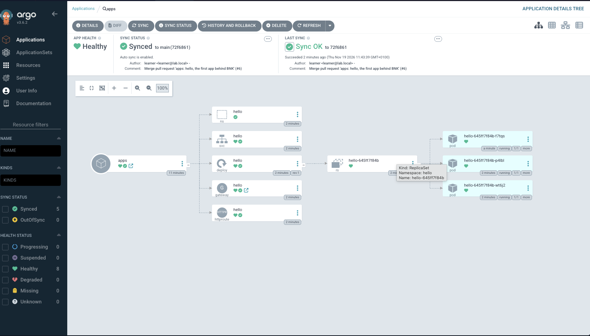

# Monday, 16:00: the first request through BIG-IP Next



---

## Step 1: Check the platform half is in place

```run
kubectl get gatewayclass f5-gateway-class
kubectl -n f5-bnk get f5-spk-vlans
kubectl -n f5-bnk get f5-bnkgateways -o yaml | yq '.items[0].spec.ingressConfig.defaultListenerNetworks'
```

- The GatewayClass is **Accepted**. BNK's controller, `f5.com/f5-bnk-f5-cne-controller`, owns it.
- Two VLANs, `external` and `internal`, both **Ready**: *CR config sent to all grpc endpoints*, which
  means TMM received them.
- One address pool, `10.30.30.10` to `10.30.30.29`, handed out by `f5-ip-provider`. Your first
  Gateway gets `.10`.

---

## Step 2: Read the app

Open `docs/examples/hello/hello.yaml` in **VS Code**. Five objects:

| Object | Purpose |
|---|---|
| `Namespace hello` | the app team's own space |
| `Deployment hello` | **three** copies of `traefik/whoami`, a tiny web server that answers with its own pod name and the request it received |
| `Service hello` | one stable name for the three pods |
| `Gateway hello` | *"give me an HTTP listener on port 80, at `10.30.30.10`, from `f5-gateway-class`"* |
| `HTTPRoute hello` | *"send everything on that listener to Service `hello`"* |

> ### Concept: what BNK does with a Gateway
> BNK's controller sees the Gateway, takes the address from its pool, and configures TMM with a
> **virtual server** on `10.30.30.10:80`. A virtual server is BIG-IP's oldest idea: an address and
> port that TMM answers on, with a **pool** of servers behind it. The HTTPRoute becomes that
> virtual server's routing, and its pool members are the **pod IPs** behind Service `hello`, not
> the Service's own address. So TMM balances straight to the pods, and follows them as they come and
> go.

---

## Step 3: Ship it through git

Copy the example into `apps/`, the folder that gets delivered to the cluster:

```run
cd /root/workspace/bnk-host-deploy && git checkout -q main && git pull -q && git checkout -b hello-app
mkdir -p apps/hello && cp docs/examples/hello/hello.yaml apps/hello/hello.yaml
git add apps/hello && git commit -m "apps: hello, the first app behind BNK" && git push -u origin hello-app
```

**Open the pull request, wait for its checks, then merge:**

1. In the **Gitea** tab, click **New Pull Request** on the green banner *You pushed on branch …*, and
   **Create** it.
2. **Wait for the checks.** The pull request's Conversation tab lists its workflow runs (`ci`, and
   `plan` when a cluster file changed), and so does **Actions**. A yellow dot means still running.
   Wait until every one shows a green tick.
3. Press **Merge**.

Nothing reaches the cluster until this merge lands on `main`.

How the merged app reaches the cluster depends on the path you took. Ask the lab:

```run
lab owner
```

| `lab owner` says | What delivers `apps/` | What you do |
|---|---|---|
| **pipeline** (path A) | the `apps` workflow: a server-side dry run, then `kubectl apply` | watch it in **Gitea > Actions** |
| **argocd** (path C) | Argo CD's `apps` Application, automatically, within about a minute | watch it in the **Argo CD** tab |
| **forge** (path B) | nobody. Forge installs the platform, and app teams ship their own way | `lab deliver` applies it for you |

Then hand it over, whatever your path. `lab deliver` does the right thing for each owner: on the
pipeline and Argo CD paths it only tells you what delivers it (and whether you have merged yet), on
the Forge path it applies the file itself, because there nobody else will:

```run
lab deliver apps/hello/hello.yaml
```

On the Argo CD path, the `apps` Application grows a tree of the five objects, all Synced and
Healthy:



Whichever path, watch the objects come up:

```run
kubectl -n hello get deploy,pod,gateway,httproute -o wide
```

The Gateway's `ADDRESS` shows `10.30.30.10` and `PROGRAMMED` turns `True`, usually within seconds.
TMM is now answering on that VIP. The three pods are spread across all three nodes.

---

## Step 4: The first request

From the **client**, a user behind Sam's router, not inside the cluster:

```run
lab curl http://10.30.30.10/
```

The answer comes from one of the `hello` pods: `Hostname: hello-…`, its pod IP, and the request it
saw. Look closely at one line of it:

```
RemoteAddr: 172.18.0.250:33943
```

The pod did not see the client, `10.20.20.10`. It saw **`172.18.0.250`, TMM's internal self IP**.
Keep that in mind for a minute.

Now trace the path the request took:

```run
docker exec client traceroute -n -w 1 -q 1 -m 4 10.30.30.10
```

Two hops, and the second one **is the VIP**:

```
 1  10.20.20.254     the edge router
 2  10.30.30.10      TMM, answering as the VIP itself
```

> ### Concept: a full proxy
> TMM is not a router that passes your packet along. It **ends** your connection at the virtual
> server, then opens a **second connection** of its own to a pod. That is why the trace stops at
> `10.30.30.10`, and why the pod saw TMM's address: TMM translates the source of the second
> connection to its internal self IP (**SNAT automap**), so the pod's reply always comes back
> through TMM, whatever the pod's own routing says.
>
> Two connections with TMM in the middle of both is called a **full proxy**. It is what lets
> BIG-IP inspect, rewrite and protect traffic, rather than just forward it.

| Hop | Who | Why it knows the way |
|---|---|---|
| client to `10.20.20.254` | Sam's edge router | the client's default route |
| router to `10.10.10.11` | TMM's external self IP, the next hop | the router's route `10.30.30.0/24 via 10.10.10.11` |
| `10.30.30.10` | the virtual server on TMM | BNK programmed it from your Gateway |
| TMM to a pod | a `hello` pod | the virtual server's pool, kept current by BNK's controller |

This morning, in challenge 2, the same trace died after hop 1. The router knew where to send it,
but nothing owned the address.

---

## Step 5: Load balancing, and a pod that dies

Send twelve requests and count which pod answered each:

```run
for i in $(seq 1 12); do lab curl http://10.30.30.10/ | grep Hostname; done | sort | uniq -c
```

All three pods answer, roughly in turn. Now delete one pod and send traffic straight away:

```run
kubectl -n hello delete pod "$(kubectl -n hello get pod -o jsonpath='{.items[0].metadata.name}')" --wait=false
for i in $(seq 1 12); do lab curl -o /dev/null -w '%{http_code} ' http://10.30.30.10/; done && echo
```

Twelve times `200`. The Deployment started a replacement, Kubernetes reported both changes, and
BNK's controller updated TMM's pool: the dying pod out, the new one in. No request failed.

Now ask TMM what it saw. The debug sidecar from challenge 6 also keeps per-virtual-server counters:

```run
T=$(kubectl -n f5-bnk get pod -l app=f5-tmm -o name | head -1)
kubectl -n f5-bnk exec $T -c debug -- tmctl -w 250 -d blade virtual_server_stat -s name,clientside.cur_conns,clientside.tot_conns
```

One line is yours: **`hello-hello-10.30.30.10-http-80-vs`**. BNK named the virtual server after where
it came from: namespace `hello`, Gateway `hello`, VIP `10.30.30.10`, listener `http`, port `80`.
`clientside.tot_conns` counts every client connection TMM accepted on it, one per `lab curl` you sent.
Send three more requests and run it again: the count goes up by three. Your Gateway is now an object
inside TMM, with its own statistics, exactly like a virtual server on any BIG-IP.

The **Lab Topology** tab now lists `hello/hello @ 10.30.30.10 (programmed)` under Gateways.

Priya leans back. *"Six clusters,"* she says, *"and this is the first one where I could tell you
exactly how it got here."*

Press **Check**. It sends a request from the client and expects a `hello` pod to answer.
