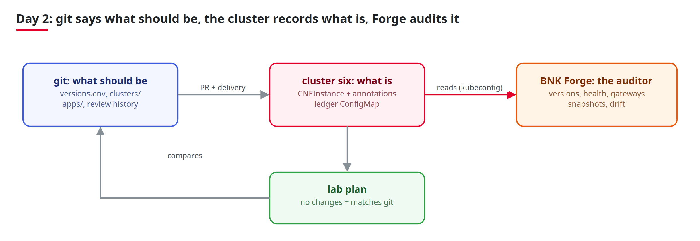
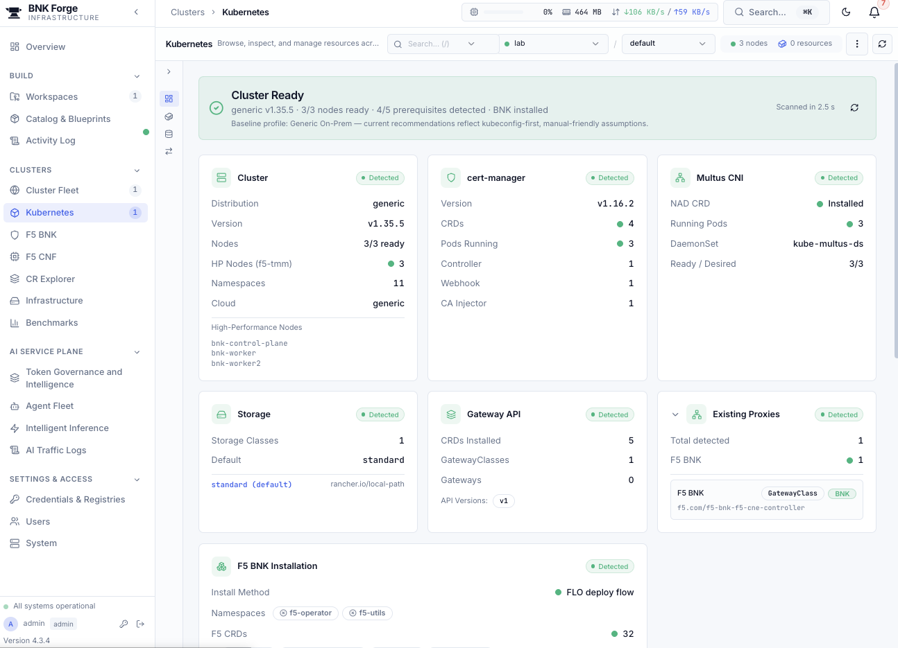
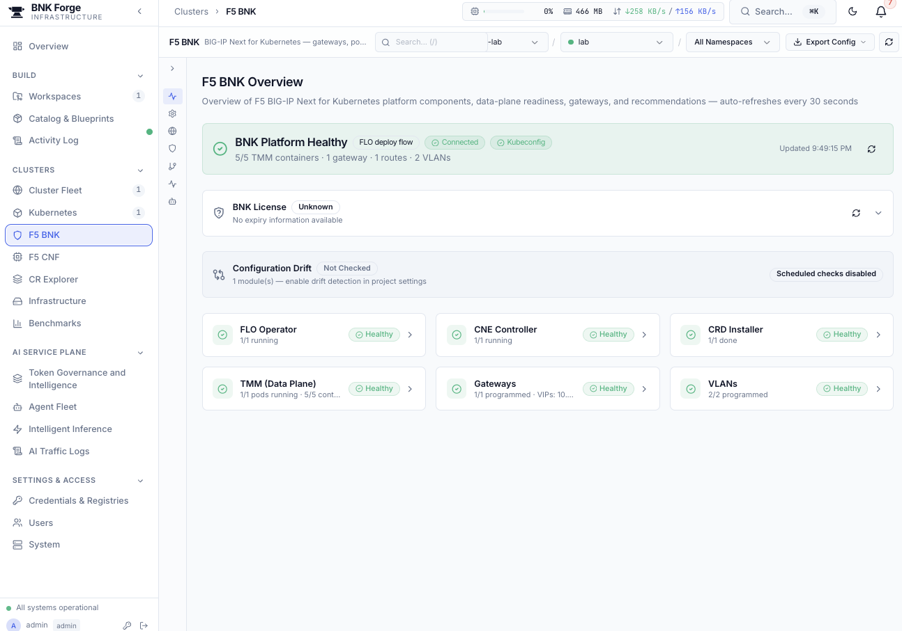
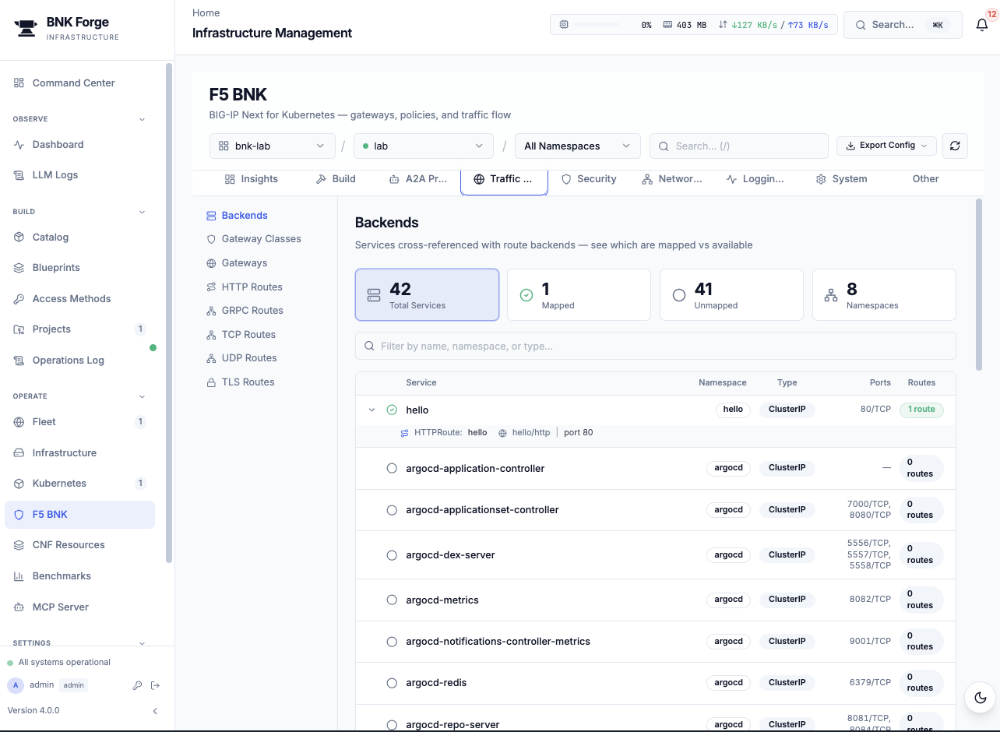
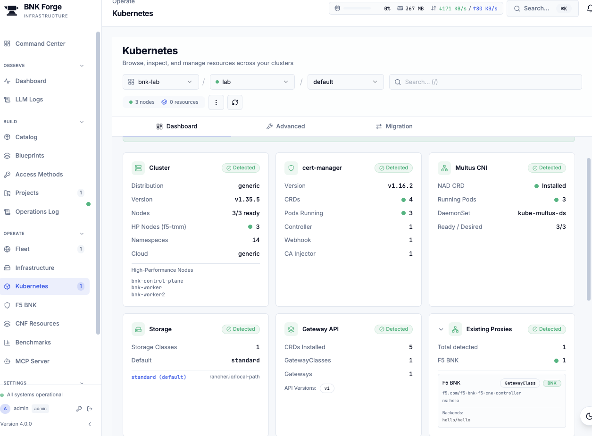
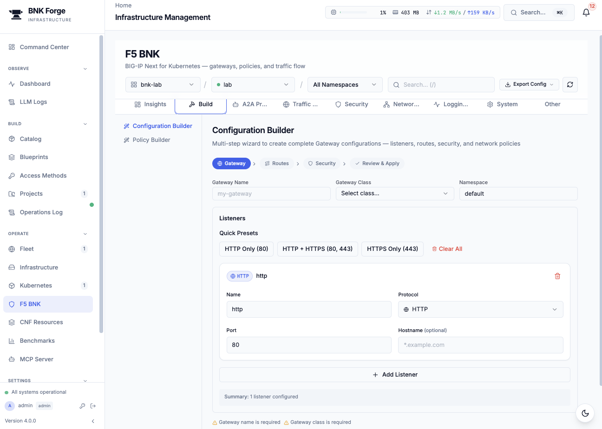

# Four weeks later: Jonas comes to audit



---

## Step 1: Make Forge ready to audit

Forge is the auditor's window for every cluster, whichever tool installed BNK. Get it ready:

```run
lab forge-ready
```

This is safe to run on any path:

| Your path | What the command does |
|---|---|
| **B, Forge** | Forge is already running, and it registered cluster `lab` when it installed BNK. Nothing to do |
| **A or C** | installs Forge as an **operations tool only**, so `BNK_INSTALLER` keeps its value, then registers cluster `lab` in a Forge project called `operations` |

Sign in to the **BNK Forge** tab as `admin`. The password is in `/root/.lab/forge-password`.

Check who owns installs, so the change in step 5 goes through the right tool:

```run
lab owner
```

---

## Step 2: Answer Jonas from Forge

In Forge, pick your project (`bnk-lab` on path B, `operations` on paths A and C) and the cluster
`lab` at the top of each page. Then work through Jonas's questions.

**1. Which release is running?** Open **Operate > Kubernetes**, scroll to **F5 BNK Installation**:



Install method *FLO deploy flow*, FLO **2.30.0-0.11.4**, TMM 5/5, and the two VLANs with their self
IPs on interfaces 1.1 and 1.2. Every value matches `versions.env` and `clusters/lab.network.yaml`.

**2. Is it healthy?** Open **F5 BNK > Insights > Health Dashboard**:



*BNK Platform Healthy*, and Forge has noticed your app by itself: **1 gateway, 1 route**.

**Is it licensed?** Forge's licence card says *Unknown*, because this Forge version cannot yet read
the licence status that BNK 2.4.2 reports. Its CWC row shows the licensing service *reachable* and
*set up*, so the plumbing is fine. Ask the cluster itself:

```run
lab status
```

`licence Active (eval, expires …)`. An auditor accepts the system of record, and for the licence
that is the cluster's `License` object.

**3. What does it expose?** Open **F5 BNK > Traffic > Backends**:



Of every Service in the cluster, exactly **one** is exposed through BNK: `hello`, by HTTPRoute `hello`
on listener `hello/http`, port 80. Everything else is internal. That one line is the answer to *"what
does this cluster expose?"*

The **Kubernetes** dashboard tells the same story from the platform side, *Gateways 1* and an F5 BNK
proxy with backend `hello/hello`:



> ### Going further: build a Gateway in Forge
> **F5 BNK > Build > Configuration Builder** is a wizard that writes a Gateway, its routes and its
> security settings for you, then reviews and applies them. It is a quick way to learn the Gateway
> API's shape. At Northwind, the YAML it produces still goes into git through a pull request.
>
> 

Now hold Forge's answers against git, line by line:

```run
grep -E '^(BNK_VERSION|CNE_RELEASE_MANIFEST|FLO_VERSION)=' /root/workspace/bnk-host-deploy/versions.env
kubectl -n f5-bnk get cneinstance f5-bnk-instance -o jsonpath='{.spec.manifestVersion}{"\n"}'
helm -n f5-cne-core list -o json | jq -r '.[] | "\(.name) \(.chart)"'
```

Git pins 2.4.2 and FLO v2.30.0-0.11.4. The cluster runs 2.4.2 and FLO v2.30.0-0.11.4.

---

## Step 3: Who installed it, from what, and when

Every successful install stamped its provenance on the CNEInstance and appended a line to a ledger
in the cluster:

```run
kubectl -n f5-cne-core get configmap bnk-deploy-ledger -o json | jq -r '.data | to_entries[] | .value | fromjson | "\(.at)  by \(.by) (\(.actor))  release \(.release)  commit \(.commit[0:12])  \(.run)"'
```

Each line says when, which orchestrator and which actor, which release, which commit, and, for the
pipeline, a link to the very run that did it. Notice the two kinds of commit. A pipeline line records the commit
on `main` it deployed. A Forge or Argo CD line records the commit the installer **image** was built
from in challenge 4, because that image, pinned by digest, is the code they ran. A commit ending in `-dirty` would mean the image was
built from uncommitted changes, and the record says so rather than claiming more than it can prove.

> ### Concept: provenance
> **Provenance** is the chain from a running thing back to its origin: this cluster, installed by
> this tool, from this image digest, built from this commit, approved in this pull request. Each link
> is recorded by a machine at the moment it happened. That is why Jonas can trust it more than a
> spreadsheet: nobody typed it in afterwards.

---

## Step 4: Does the cluster still match git?

Run a plan against `main`. If nothing has drifted, it finds nothing to do:

```run
lab plan --summary
```

Every phase reports *already*: the label, the operator, `CNEInstance f5-bnk-instance: live object
already matches`, `TMM network: live objects already match`, `licence already Active`.

On the CI/CD path, the `drift` workflow runs exactly this every morning and opens an issue in Gitea
when a cluster stops matching. Someone who "just fixed something by hand" is found the next day,
not at the next outage.

---

## Step 5: A Day-2 change, through git

The hello app needs more capacity: five replicas instead of three. A change, so a pull request:

```run
cd /root/workspace/bnk-host-deploy && git checkout -q main && git pull -q && git checkout -b hello-five
sed -i 's/replicas: 3/replicas: 5/' apps/hello/hello.yaml && git diff
git commit -qam "apps/hello: 5 replicas" && git push -u origin hello-five
```

**Open the pull request, wait for its checks, then merge:**

1. In the **Gitea** tab, click **New Pull Request** on the green banner *You pushed on branch …*, and
   **Create** it.
2. **Wait for the checks.** The pull request's Conversation tab lists its workflow runs (`ci`, and
   `plan` when a cluster file changed), and so does **Actions**. A yellow dot means still running.
   Wait until every one shows a green tick.
3. Press **Merge**.

Nothing changes on the cluster until it lands on `main`. Then let your path deliver it, exactly as
in challenge 10:

| `lab owner` says | Delivery |
|---|---|
| **pipeline** | the `apps` workflow runs on the merge. Watch **Gitea > Actions** |
| **argocd** | Argo's `apps` Application notices within about a minute |
| **forge** | `lab deliver` applies it |

Then, whatever your path:

```run
lab deliver apps/hello/hello.yaml
```

Wait until five pods run, then send traffic:

```run
kubectl -n hello rollout status deploy/hello && kubectl -n hello get pods && lab spread 20
```

**Five** pod names in the count. If you still see three, the delivery has not happened yet: give it
a minute and run the command again.

Nobody touched TMM, the router or BNK. The app team merged a change, Kubernetes started two pods,
and BNK's controller added them to the virtual server's pool.

> ### What an upgrade looks like here
> Upgrading BNK is the same motion, just bigger. A pull request changes `versions.env`
> (`BNK_VERSION`, `CNE_RELEASE_MANIFEST`, and `FLO_VERSION`, read from the new release manifest).
> `ci/targets.sh` selects **every enabled cluster**. The plan shows each cluster's diff on the pull
> request (`manifestVersion: 2.4.2` to the next release, the new FLO chart). The merge rolls it out,
> one cluster after another. Forge's **Upgrade** view then confirms
> each cluster's new release and health, and the ledger gains one line per cluster.

---

## What you did, and who did it for you

| F5 guide step | Who did it |
|---|---|
| Prepare your computer and cluster | `00-preflight`, `05-nodes`, `10-prereqs` |
| Download the FAR key and the licence | the lab vault, into CI secrets, Forge secrets or an Argo CD Secret |
| Create a pull-secret manifest for FAR | `20-registry` |
| Install FLO | `30-flo` |
| Install a CNE instance | `40-certs`, `45-attachments`, `50-cneinstance`, `55-network` |
| License your cluster | `60-license`, `65-ready` |
| Verify | `70-verify`, provenance, the nightly drift check |

You did not run one of those steps by hand. You declared a cluster in git, chose a tool to apply it,
sent traffic through it, audited it, and changed it through review.

Jonas closes his laptop after eight minutes. *"Can the other five clusters work like this?"*

Priya looks at you. That is next quarter's project.

Press **Check**. It confirms five hello pods answer through BNK.
