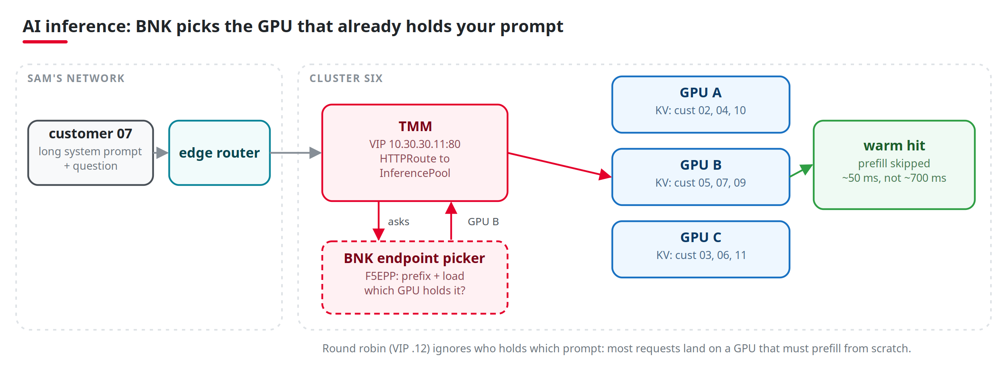
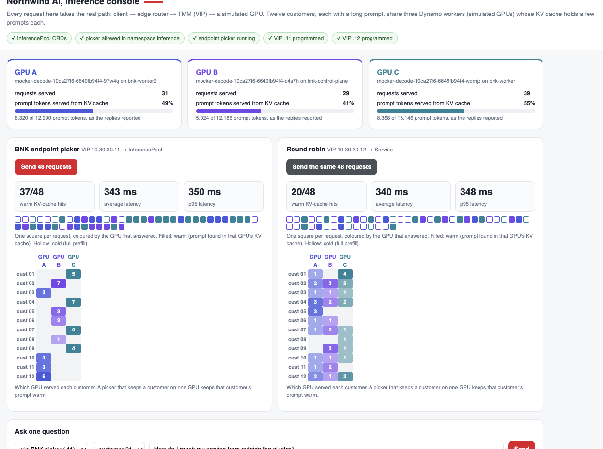

# Two days later: the AI team moves in



---

## Step 1: The idea, in Kubernetes terms

The **Gateway API Inference Extension** adds two things to the Gateway API you used in challenge 10:

| Object | What it is |
|---|---|
| **InferencePool** | a set of model-server pods, like a Service, but meant to be routed to *one request at a time* by a picker |
| **endpoint picker** | a small service the gateway asks, for every request: *which pod should take this one?* It looks at the prompt and at each pod's live metrics (queue, KV-cache use) |

An HTTPRoute can point at an InferencePool instead of a Service. Then, for every request, TMM
pauses, asks the picker, and sends the request to the pod the picker names.

**BNK ships its own endpoint picker, F5EPP.** You declare one `F5EPP` object, and BNK's controller
runs the picker for you. For safety, the controller only does that in namespaces the platform team
has approved, in the CNEInstance's `eppNamespaces` list. That approval is a platform change, so it
goes through git like every other.

---

## Step 2: The platform change (platform team)

Approve the namespace `inference` for endpoint pickers. Start a branch:

```run
cd /root/workspace/bnk-host-deploy && git checkout -q main && git pull -q && git checkout -b enable-inference
```

Open `clusters/lab.yaml` in **VS Code** and add, at the end of the file:

```yaml
inference:
  epp_namespaces: [inference]
```

Save, then validate, commit and push:

```run
./tests/cluster.sh clusters/lab.yaml && git commit -qam "clusters/lab: let BNK run endpoint pickers in namespace inference" && git push -u origin enable-inference
```

**Open the pull request** in **Gitea**: click **New Pull Request** on the green banner and **Create** it.
Do not merge yet, read on first. What this change makes the installer do:

| Phase | Action |
|---|---|
| **47 inference** (new) | installs the Inference Extension CRDs (InferencePool), then creates namespace `inference` with F5's pull secret |
| **50 CNEInstance** | adds `eppNamespaces: [inference]`, so BNK's controller may run pickers there |

> ### Concept: why phase 47 must run first
> The moment the CNEInstance lists an EPP namespace, BNK's controller restarts and starts watching
> InferencePool objects. If that resource type does not exist yet, the controller exits, and TMM
> stops being configured. The installer encodes the order once: CRDs and namespace in phase 47,
> the CNEInstance change in phase 50. Nobody has to remember it at two in the morning.

Now deliver it the way your path delivers platform changes. Check your path:

```run
lab owner
```

**If `lab owner` says `argocd`:**

1. Merge the pull request once `ci` is green (above).
2. In the **Argo CD** tab, open the application **`bnk-install`** and press **Refresh**. Within seconds it
   turns **OutOfSync**: the ConfigMap Argo builds from `clusters/` has a new content hash, because
   `lab.yaml` changed. **App Diff** shows the new `inference:` block.
3. Press **Sync**, tick **PRUNE**, and press **Synchronize**. Argo starts the install Job again.

   > **Why Prune?** The ConfigMap is named after its content, so your change created a *new* one,
   > `bnk-cluster-<new hash>`. The old one is no longer in git, and Argo marks it *not present in the
   > application's source*. Prune tells Argo to delete what git no longer describes. Without it, the
   > install still runs, but the old ConfigMap lingers and `bnk-install` never shows Synced. That is
   > GitOps in one checkbox: git is the truth, in both directions.
4. Click the **Job**, then its **pod**, then **Logs**. The installer converges every phase. Watch for
   the new ones: phase **47** prints *Inference Extension CRDs v1.4.0 installed* and *endpoint-picker
   namespace inference prepared*, phase **50** applies the CNEInstance with `eppNamespaces`, and
   **70** adds two inference checks to its list.
5. Wait for **Sync OK** on `bnk-install`, two to four minutes.

**If `lab owner` says `pipeline`:**

1. Wait for the `plan` comment on the pull request. It lists the phase 47 actions and the CNEInstance
   diff, `+ eppNamespaces: [inference]`. That is your review.
2. Merge. In **Actions**, open the `deploy` run and follow phases 47 and 50 in its log until it is green.

**If `lab owner` says `forge`:**

1. Merge once `ci` is green, for the record. Forge runs the installer image you built in challenge 4,
   whose built-in cluster file does not know about this change, so make it in Forge itself:

   ```run
   lab forge-input bnk-lab epp_namespaces inference
   ```

2. In **BNK Forge**, open project **bnk-lab** and press **Deploy all**. In the module's log, the
   `50 CNEInstance` step now runs phase 47 first, then applies the CNEInstance.

When it has landed, confirm:

```run
kubectl get crd inferencepools.inference.networking.k8s.io
kubectl -n f5-bnk get cneinstance f5-bnk-instance -o jsonpath='{.spec.eppNamespaces}{"\n"}'
kubectl get ns inference --show-labels
lab status
```

The CRD exists, the CNEInstance lists `["inference"]`, the namespace is there, and `lab status` still
shows BNK Available. The controller restarted cleanly.

> **Wait for this before step 4.** The app in step 4 uses the InferencePool type and the `inference`
> namespace that this platform change creates. Ship the app before the change has landed and the
> cluster refuses it: *no matches for kind InferencePool*, *namespace inference not found*. Platform
> first, then apps, every time.

---

## Step 3: The inference runtime (platform team)

Mei's models run on NVIDIA Dynamo, so the cluster needs Dynamo's operator, and NATS, the message bus
its workers publish KV-cache events on. Like Argo CD, it is a platform component you install once:

```run
lab dynamo
```

Three blocks: the Dynamo platform 1.5.1 Helm chart (operator and NATS), a NetworkPolicy so that only
the namespaces approved for pickers may talk to NATS (anyone who could publish fake KV events could
steer BNK's picker), and the namespace `inference` made ready for Dynamo workers.

---

## Step 4: The AI team's change (app team)

Read the app in **VS Code**: `docs/examples/inference/inference.yaml`.

| Object | Purpose |
|---|---|
| `DynamoGraphDeployment mocker` | Dynamo's frontend plus three **decode workers**, one per node. Each worker's KV cache holds only a few customers' prompts, like a busy GPU. Each worker pod has a small Dynamo frontend beside it in *direct* mode: it serves exactly the worker BNK's picker named |
| `InferencePool model-pool` | the three decode workers, as one pool the picker routes to |
| `F5EPP model-pool-epp` | BNK's endpoint picker for the pool, engine **dynamo**: it subscribes to the workers' KV-cache events on NATS. BNK's controller turns this one object into a running picker |
| `Gateway ai-picker` + `HTTPRoute chat` | VIP **10.30.30.11**: requests go to the InferencePool, so BNK's picker decides |
| `Gateway ai-roundrobin` + `HTTPRoute chat-rr` | VIP **10.30.30.12**: Dynamo's own frontend, in its default round-robin mode, for comparison |

Ship it like the hello app:

```run
cd /root/workspace/bnk-host-deploy && git checkout -q main && git pull -q && git checkout -b inference-app
mkdir -p apps/inference && cp docs/examples/inference/inference.yaml apps/inference/
git add apps/inference && git commit -qm "apps: inference, three Dynamo workers behind BNK's endpoint picker" && git push -u origin inference-app
```

**Open the pull request, wait for its checks, then merge:**

1. In the **Gitea** tab, click **New Pull Request** on the green banner *You pushed on branch …*, and
   **Create** it.
2. **Wait for the checks.** The pull request's Conversation tab lists its workflow runs (`ci`, and
   `plan` when a cluster file changed), and so does **Actions**. A yellow dot means still running.
   Wait until every one shows a green tick.
3. Press **Merge**.

Then hand it over as in challenge 10:

```run
lab deliver apps/inference/inference.yaml
```

Watch it come up. Dynamo's operator starts the frontend and the three workers (the first image pull
takes a few minutes), and BNK renders the picker's own pod next to them:

```run
kubectl -n inference get pods,inferencepool,f5-epps,gateway -o wide
```

Both Gateways get their addresses, `10.30.30.11` and `10.30.30.12`, and turn `PROGRAMMED True`.

---

## Step 5: Ask one question, twice

From the client behind Sam's router, ask as customer 7:

```run
lab ask 7 "How do I reach my service from outside the cluster?"
lab ask 7 "And how do I make it highly available?"
```

The first answer is **cold**: none of customer 7's prompt was in any GPU's KV cache, so the worker
prefilled all of it (`KV cache: 0 of 425 prompt tokens`). The second is **warm**: BNK's picker sent it
to the GPU that now held the prompt, and that GPU reused it (`400 of 423`). Ask a third question and it
lands warm on the same GPU again. `lab ask` names the GPU each time.

The latency hardly changes, and that is expected here: Mocker models a fast data-center GPU, where a few
hundred prompt tokens take milliseconds to prefill. What changed is the **work**: 400 tokens the GPU did
not have to compute again.

Now the same question through round robin:

```run
lab ask --rr 7 "And how do I make it highly available?"
```

Round robin does not know who holds what. Run it a few times: some answers are warm, by luck, most
are not.

---

## Step 6: Twelve customers, three GPUs

Open the **AI Inference** tab. The top shows the three GPUs, read live from each model server's own
vLLM metrics: requests served, and **KV-cache hit rate**, the share of prompt tokens served from the
cache instead of computed.

Press **Send 48 requests** under *BNK endpoint picker*. 48 requests from the twelve customers, in a
fixed random order, go through VIP `.11`. Then press **Send the same 48 requests** under *Round robin*:
the identical sequence through `.12`.

Here is a run on this very lab, BNK's picker on the left, round robin on the right:



Read the two panels side by side:

| | Look for |
|---|---|
| **warm KV-cache hits** | how many of the 48 found their prompt already cached. On BNK in this lab: about **37** with the picker, about **20** with round robin |
| **prefill saved** | the share of all prompt tokens served from KV cache instead of computed again |
| **average latency** | about the same on both sides here, and that is honest: Mocker models a fast data-center GPU, where a few hundred tokens of prefill take milliseconds. The saving shows as latency with long contexts and under load, and as capacity always |
| **the strip** | one square per request, coloured by the GPU that answered. Filled is warm, hollow is cold |
| **the customer grid** | with the picker, each customer sits in **one** GPU column. With round robin, every customer is smeared across all three, and every GPU keeps evicting prompts it will need again |

The same in the terminal, if you prefer:

```run
lab gpus
```

> ### Concept: what the picker is actually doing
> For every request, TMM sends BNK's picker the request's details over a gRPC side channel
> (**ext_proc**). The picker scores every pod: does it recently hold this prompt's prefix, how long is
> its queue, how full is its KV cache. It names the winner, and TMM sends the request there. It is
> the same full proxy you met in challenge 10, with a far smarter way of choosing the pool member.
>
> BNK's picker runs in **precise** mode: it does not guess. Every Dynamo worker publishes KV-cache
> events on NATS (*stored these blocks, evicted those*), and the picker keeps an index of exactly
> which blocks each GPU holds. Read it in the picker's own log:
>
> ```
> kubectl -n inference logs deploy/model-pool-epp | grep -E 'transport=|first message'
> ```
>
> `KV-events transport=nats (dynamo-wire)`, then *first message received* on the workers'
> `kv-events` and `kv_metrics` subjects. No events, no prefix routing: that is why the picker needs a
> real engine such as Dynamo or vLLM behind it.

> ### Concept: why this matters on a real bill
> Prefill is the most compute-hungry part of inference. Every cold request recomputes work another
> GPU already did. Routing for cache hits turns that waste into capacity: the same three GPUs serve
> more customers, faster. Replay real production chat traces through a KV-cache simulator and the effect is large:
> prefix-aware routing with a quarter of the GPU memory per GPU still saves more prefill than round
> robin with all of it.

---

## Step 7: What you built this week

| Day | What changed | How |
|---|---|---|
| Monday | BNK installed on cluster six | a cluster file, one of three install tools |
| Monday | the first app behind a VIP | a pull request to `apps/` |
| Day 2 | audit, drift check, more capacity | Forge, the ledger, a pull request |
| Two days later | AI inference, with a GPU-aware picker | a platform pull request, then an app pull request |

Mei's reply arrives before lunch: *"Same three GPUs, half the latency. Can we move the other models
too?"*

Press **Check**. It confirms the inference CRDs, the approved namespace, the model servers, BNK's
picker, and an answer through VIP 10.30.30.11.
